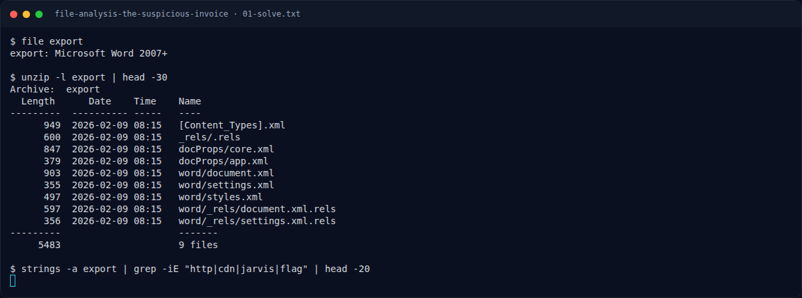

# File Analysis: The Suspicious Invoice — Jejak awal

[← Overview](73-file-analysis-the-suspicious-invoice.md) · [Index](index.md)

> **Langkah 1/5.** File invoice adalah DOCX, jadi secara fisik ia ZIP.
>
> **Berikutnya:** [Cara Mendapatkan Flag](73-file-analysis-the-suspicious-invoice-02-cara-mendapatkan-flag.md)

```bash
file export
unzip -l export
```

Tidak ada macro. Relasi yang berbahaya ada di `word/_rels/settings.xml.rels`, bukan di teks invoice.

### Evidence langkah ini



*Terminal evidence — transkrip langkah — `term-01-solve.png`.*

**Berkas mentah terkait:**

- [`01-solve.txt`](assets/file-analysis-the-suspicious-invoice/01-solve.txt)
