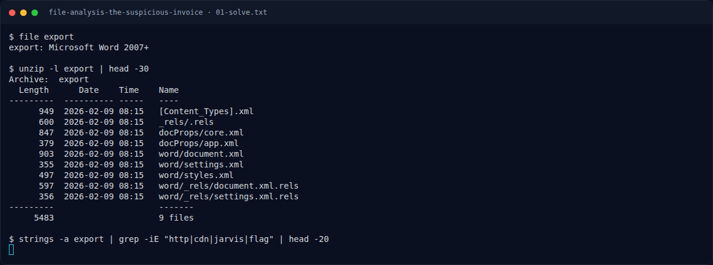

# File Analysis: The Suspicious Invoice — Flag & Verifikasi

[← Overview](73-file-analysis-the-suspicious-invoice.md) · [Index](index.md)

> **Langkah 2/5 — Cara Mendapatkan Flag.** Cara Mendapatkan Flag
>
> **Titik penting:** NFX{zip_t1221_cdn-jarvis-update.example_jarvis-ir-case-2026-0211}
>
> **Berikutnya:** [Flag](73-file-analysis-the-suspicious-invoice-03-flag.md)

> **Flag:** `NFX{zip_t1221_cdn-jarvis-update.example_jarvis-ir-case-2026-0211}`
> **Status:** `VERIFIED`

1. Cek file dan metadata:
```bash
file export
exiftool export
```
2. Cari ZIP/attachment dan ekstrak.
3. Baca domain/URL dan case ID, lalu susun flag sesuai format.

### Terminal evidence (real)



*Terminal evidence (real).*

> **Bukti:** terminal evidence (real).
