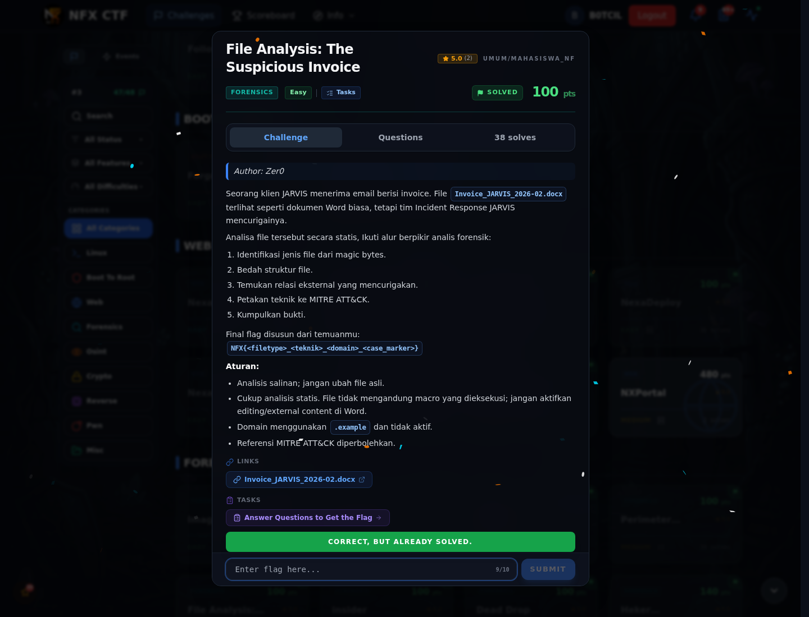

# File Analysis: The Suspicious Invoice — Flag & Verifikasi

[← Overview](73-file-analysis-the-suspicious-invoice.md) · [Index](index.md)

> **Langkah 3/5 — Flag.** Flag
>
> **Titik penting:** NFX{zip_t1221_cdn-jarvis-update.example_jarvis-ir-case-2026-0211}
>
> **Berikutnya:** [Bukti / Evidence](73-file-analysis-the-suspicious-invoice-04-bukti-evidence.md)

> **Flag:** `NFX{zip_t1221_cdn-jarvis-update.example_jarvis-ir-case-2026-0211}`
> **Status:** `VERIFIED`

```text
NFX{zip_t1221_cdn-jarvis-update.example_jarvis-ir-case-2026-0211}
```

### Bukti submit di platform



*Submit flag di platform: `CORRECT, BUT ALREADY SOLVED.`*

> **Bukti submit:** screenshot form challenge di atas menampilkan `CORRECT, BUT ALREADY SOLVED.`
