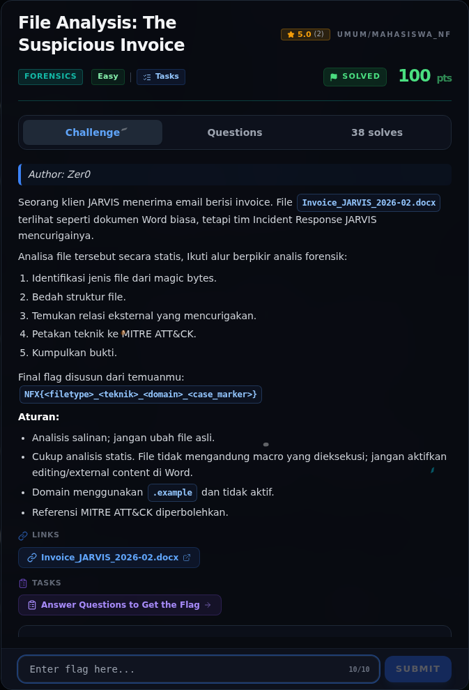
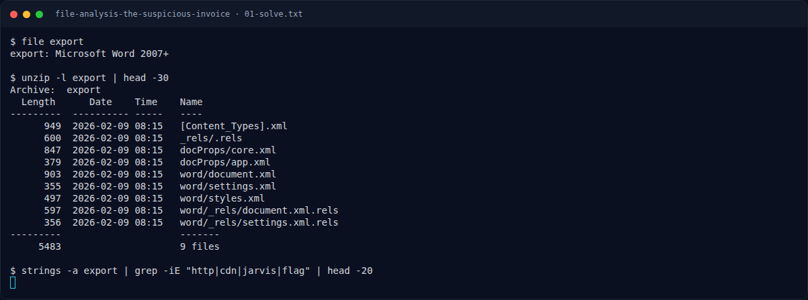

# File Analysis: The Suspicious Invoice

Track Mahasiswa NF · ForensicsEasy100 poinVERIFIED

| Field | Nilai |
|---|---|
| Event | `umum/mahasiswa_nf` |
| Kategori | `Forensics` |
| Author | `Zer0` |
| Difficulty | `Easy` |
| Poin (snapshot) | `100` |
| Tools | exiftool |
| Flag | `NFX{zip_t1221_cdn-jarvis-update.example_jarvis-ir-case-2026-0211}` |
| Status | `VERIFIED` |
| Snapshot | 2026-11-13 |

[← Kembali ke Index](index.md)

## TL;DR

- **Flag:** `NFX{zip_t1221_cdn-jarvis-update.example_jarvis-ir-case-2026-0211}`
- **Baca langkah lengkap:** [Cara Mendapatkan Flag](73-file-analysis-the-suspicious-invoice-02-cara-mendapatkan-flag.md)

## Challenge Brief (platform)

*Challenge brief asli di platform NFX CTF 2026.*

## Alur & Titik Penting

| # | Langkah | Titik penting | Buka |
|---:|---|---|---|
| 1 | Recon Artefak | DOCX = ZIP, ada `attachedTemplate`. | [Buka](73-file-analysis-the-suspicious-invoice-01-recon-artefak.md) |
| 2 | Cara Mendapatkan Flag | T1221 + domain + case ID. | [Buka](73-file-analysis-the-suspicious-invoice-02-cara-mendapatkan-flag.md) |
| 3 | Flag | NFX{zip_t1221_cdn-jarvis-update.example_jarvis-ir-case-2026-0211} | [Buka](73-file-analysis-the-suspicious-invoice-03-flag.md) |
| 4 | Bukti / Evidence | arsip screenshot dan transkrip | [Buka](73-file-analysis-the-suspicious-invoice-04-bukti-evidence.md) |
| 5 | Referensi | File carving, ZIP extraction, IOC. | [Buka](73-file-analysis-the-suspicious-invoice-05-referensi.md) |

## Cerita singkat

DOCX adalah ZIP. `settings.xml.rels` menunjuk template eksternal (T1221). Flag disusun dari tipe file, teknik, domain, dan case ID di metadata.

Pratinjau evidence. Buka halaman <a href="73-file-analysis-the-suspicious-invoice-04-bukti-evidence.html">Evidence / Bukti</a> untuk semua screenshot dan transkrip.

## Navigasi Halaman

<a class="nx-page-card" href="73-file-analysis-the-suspicious-invoice-01-recon-artefak.html"><b>Recon Artefak</b>Enumerasi target dan bukti awal</a>
<a class="nx-page-card" href="73-file-analysis-the-suspicious-invoice-02-cara-mendapatkan-flag.html"><b>Cara Mendapatkan Flag</b>Flag dan verifikasi platform</a>
<a class="nx-page-card" href="73-file-analysis-the-suspicious-invoice-03-flag.html"><b>Flag</b>Flag dan verifikasi platform</a>
<a class="nx-page-card" href="73-file-analysis-the-suspicious-invoice-04-bukti-evidence.html"><b>Bukti / Evidence</b>Screenshot, transkrip, dan artefak</a>
<a class="nx-page-card" href="73-file-analysis-the-suspicious-invoice-05-referensi.html"><b>Referensi</b>Sumber dan bacaan lanjutan</a>

