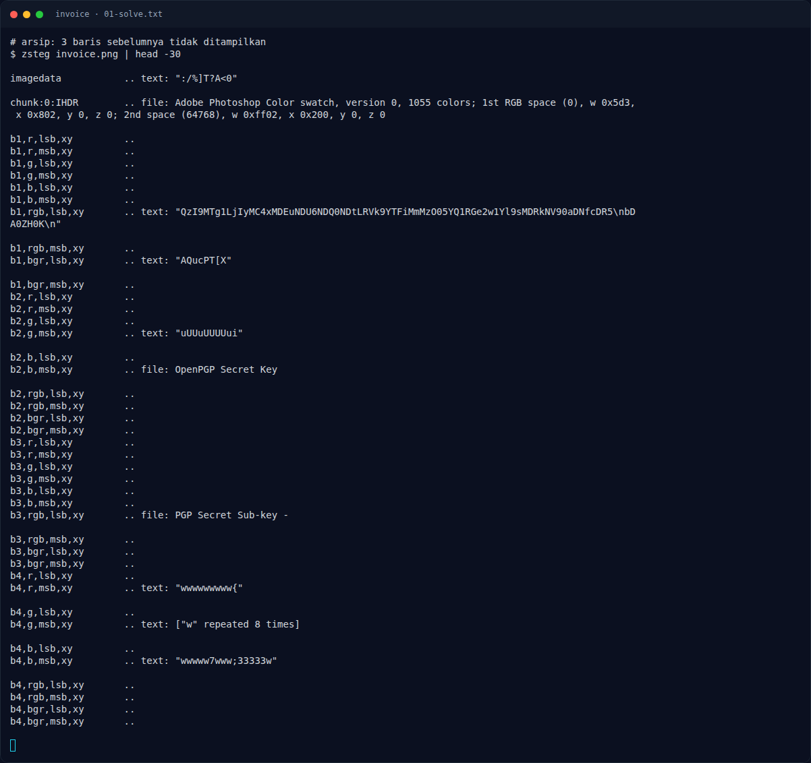

# Invoice — Flag & Verifikasi

[← Overview](74-invoice.md) · [Index](index.md)

> **Langkah 2/5 — Cara Mendapatkan Flag.** Cara Mendapatkan Flag
>
> **Titik penting:** NFXCTF{l5b_l04d5_th3_p4yl04d}
>
> **Berikutnya:** [Flag](74-invoice-03-flag.md)

> **Flag:** `NFXCTF{l5b_l04d5_th3_p4yl04d}`
> **Status:** `VERIFIED`

1. Cek gambar dengan `file`, `exiftool`, dan `zsteg`.
2. Ekstrak LSB dari kanal yang mengandung teks.
3. Decode payload untuk mendapatkan flag.

### Terminal evidence (real)

*Terminal evidence (real).*

> **Bukti:** terminal evidence (real).
