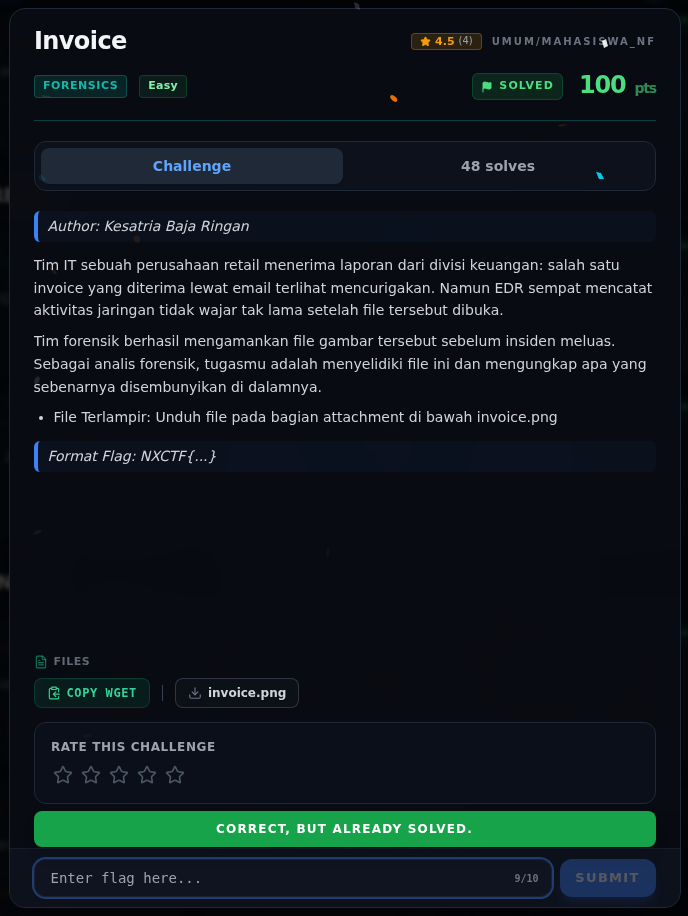

# Invoice — Flag & Verifikasi

[← Overview](74-invoice.md) · [Index](index.md)

> **Langkah 3/5 — Flag.** Flag
>
> **Titik penting:** NXCTF{l5b_l04d5_th3_p4yl04d}
>
> **Berikutnya:** [Bukti / Evidence](74-invoice-04-bukti-evidence.md)

> **Asal flag.** Flag diperoleh dari langkah exploit/solver yang terdokumentasi, lalu disubmit ke platform.  
> **Tingkat bukti metode.** Terdokumentasi. [Buka Evidence](74-invoice-04-bukti-evidence.md)

> **Status metode:** **FULL** — metode utama berhasil direproduksi.  
> **Flag:** `NXCTF{l5b_l04d5_th3_p4yl04d}`
> **Status:** `VERIFIED`

```text
NXCTF{l5b_l04d5_th3_p4yl04d}
```

### Terminal evidence (real)


*Terminal evidence (real).*

> **Bukti:** terminal evidence (real).

## Validasi platform (real)



*Screenshot asli dari platform NFX CTF 2026. Platform menjawab
`CORRECT, BUT ALREADY SOLVED.` untuk flag ini.*
