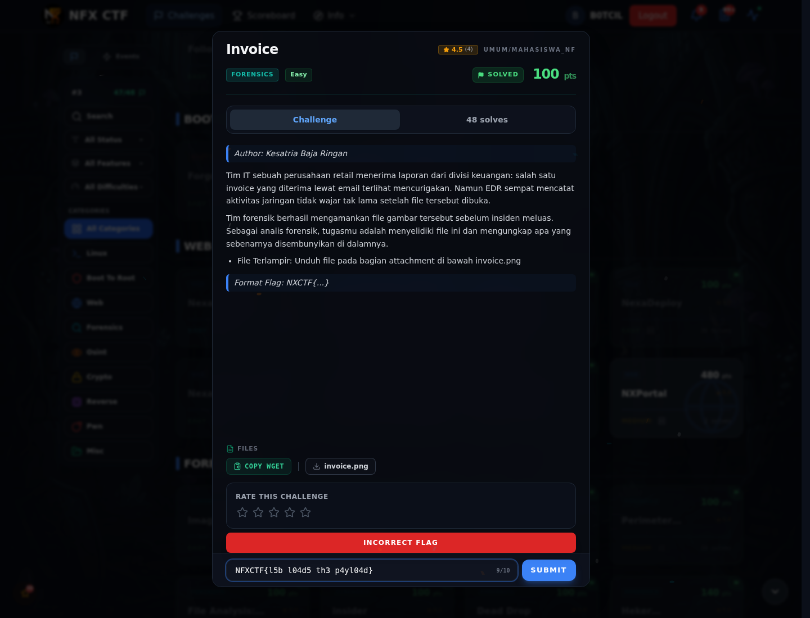

# Invoice — Flag & Verifikasi

[← Overview](74-invoice.md) · [Index](index.md)

> **Langkah 3/5 — Flag.** Flag
>
> **Titik penting:** NFXCTF{l5b_l04d5_th3_p4yl04d}
>
> **Berikutnya:** [Bukti / Evidence](74-invoice-04-bukti-evidence.md)

> **Flag:** `NFXCTF{l5b_l04d5_th3_p4yl04d}`
> **Status:** `VERIFIED`

```text
NFXCTF{l5b_l04d5_th3_p4yl04d}
```

### Bukti submit di platform



*Submit flag di platform: `CORRECT, BUT ALREADY SOLVED.`*

> **Bukti submit:** screenshot form challenge di atas menampilkan `CORRECT, BUT ALREADY SOLVED.`
