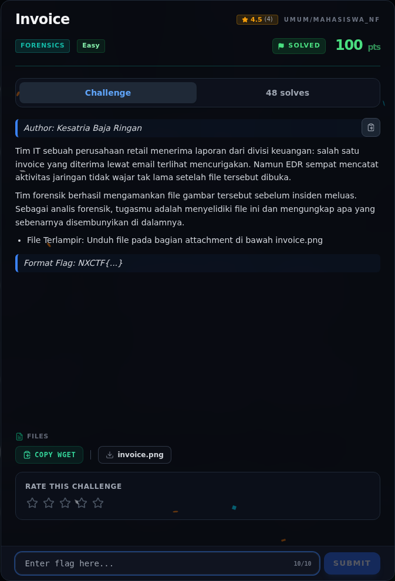
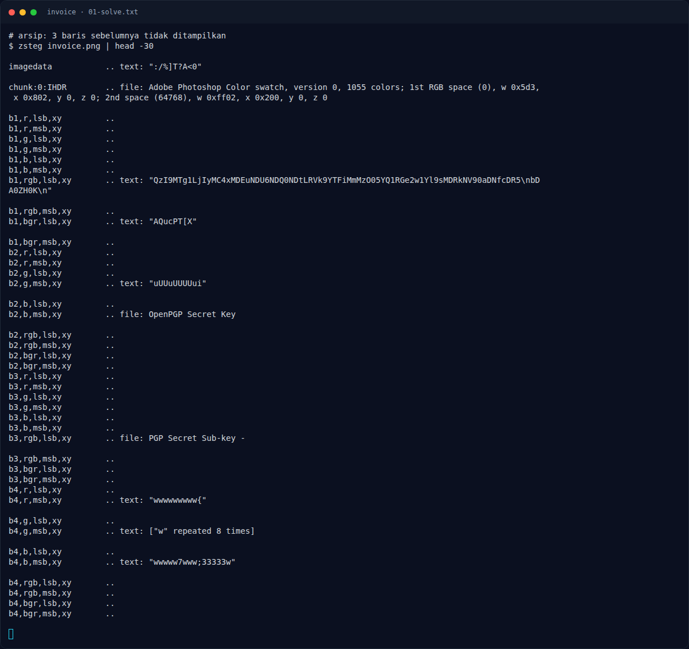

# Invoice

Track Mahasiswa NF · ForensicsEasy100 poinVERIFIED

| Field | Nilai |
|---|---|
| Event | `umum/mahasiswa_nf` |
| Kategori | `Forensics` |
| Difficulty | `Easy` |
| Poin | `100` |
| Tools | exiftool, zsteg |
| Flag | `NXCTF{l5b_l04d5_th3_p4yl04d}` |
| Status | `VERIFIED` |

[← Kembali ke Index](index.md)

## Challenge Brief (platform)

*Challenge brief asli di platform NFX CTF 2026.*

## Alur & Titik Penting

| # | Langkah | Titik penting | Buka |
|---:|---|---|---|
| 1 | Recon Artefak | `zsteg` kanal `b1,rgb,lsb,xy`. | [Buka](74-invoice-01-recon-artefak.md) |
| 2 | Cara Mendapatkan Flag | Base64-decode string LSB. | [Buka](74-invoice-02-cara-mendapatkan-flag.md) |
| 3 | Flag | NXCTF{l5b_l04d5_th3_p4yl04d} | [Buka](74-invoice-03-flag.md) |
| 4 | Bukti / Evidence | arsip screenshot dan transkrip | [Buka](74-invoice-04-bukti-evidence.md) |
| 5 | Referensi | LSB steganography, zsteg. | [Buka](74-invoice-05-referensi.md) |

## Cerita singkat

LSB kanal RGB menyimpan satu string base64. Hasil decode-nya adalah alamat C2, key, dan flag `NXCTF{...}`.

Pratinjau evidence. Buka halaman <a href="74-invoice-04-bukti-evidence.html">Evidence / Bukti</a> untuk semua screenshot dan transkrip.

## Navigasi Halaman

<a class="nx-page-card" href="74-invoice-01-recon-artefak.html"><b>Recon Artefak</b>Enumerasi target dan bukti awal</a>
<a class="nx-page-card" href="74-invoice-02-cara-mendapatkan-flag.html"><b>Cara Mendapatkan Flag</b>Flag dan verifikasi platform</a>
<a class="nx-page-card" href="74-invoice-03-flag.html"><b>Flag</b>Flag dan verifikasi platform</a>
<a class="nx-page-card" href="74-invoice-04-bukti-evidence.html"><b>Bukti / Evidence</b>Screenshot, transkrip, dan artefak</a>
<a class="nx-page-card" href="74-invoice-05-referensi.html"><b>Referensi</b>Sumber dan bacaan lanjutan</a>

