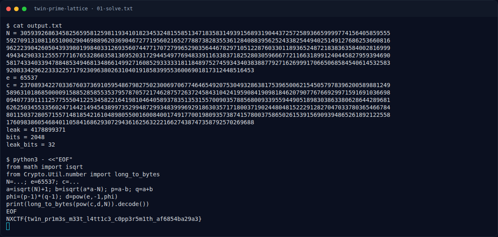

# Twin Prime Lattice — Flag & Verifikasi

[← Overview](75-twin-prime-lattice.md) · [Index](index.md)

> **Langkah 2/5 — Cara Mendapatkan Flag.** Cara Mendapatkan Flag
>
> **Titik penting:** NXCTF{tw1n_pr1m3s_m33t_l4tt1c3_c0pp3r5m1th_af6854ba29a3}
>
> **Berikutnya:** [Flag](75-twin-prime-lattice-03-flag.md)

> **Flag:** `NXCTF{tw1n_pr1m3s_m33t_l4tt1c3_c0pp3r5m1th_af6854ba29a3}`
> **Status:** `VERIFIED`

1. Baca `output.txt` (n, e, ciphertext).
2. Fermat factorization untuk mencari p dan q yang berdekatan.
3. Hitung d, dekripsi ciphertext, konversi ke flag.

### Terminal evidence (real)

*Terminal evidence (real).*

> **Bukti:** terminal evidence (real).
