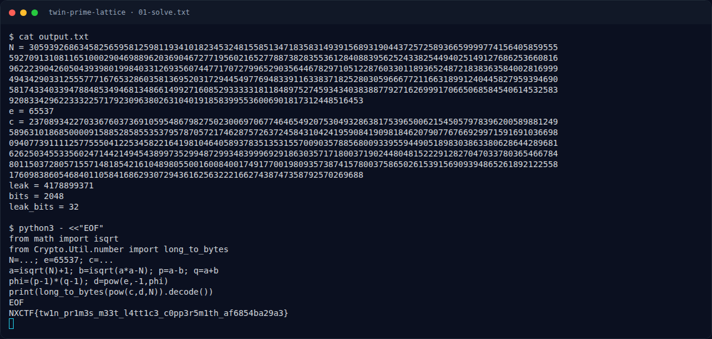

# Twin Prime Lattice — Flag & Verifikasi

[← Overview](75-twin-prime-lattice.md) · [Index](index.md)

> **Langkah 3/5 — Flag.** Flag
>
> **Titik penting:** NXCTF{tw1n_pr1m3s_m33t_l4tt1c3_c0pp3r5m1th_af6854ba29a3}
>
> **Berikutnya:** [Bukti / Evidence](75-twin-prime-lattice-04-bukti-evidence.md)

> **Flag:** `NXCTF{tw1n_pr1m3s_m33t_l4tt1c3_c0pp3r5m1th_af6854ba29a3}`
> **Status:** `VERIFIED`

```text
NXCTF{tw1n_pr1m3s_m33t_l4tt1c3_c0pp3r5m1th_af6854ba29a3}
```

### Terminal evidence (real)



*Terminal evidence (real).*

> **Bukti:** terminal evidence (real).
