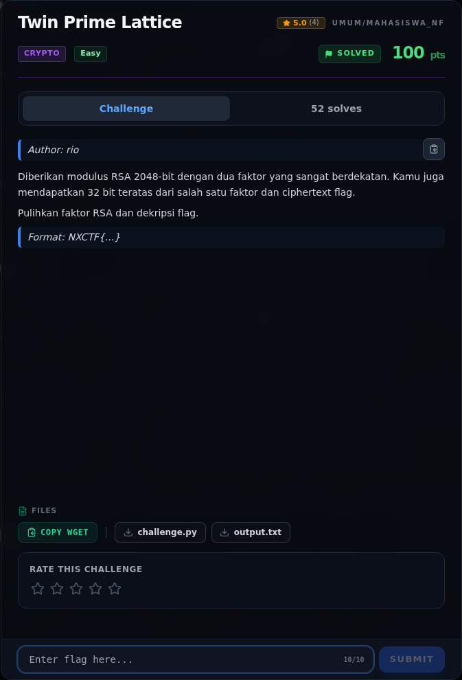

# Twin Prime Lattice — Referensi

[← Overview](75-twin-prime-lattice.md) · [Index](index.md)

> **Langkah 5/5 — Referensi.** Fermat factorization, RSA twin primes.
>
> **Titik penting:** Fermat factorization, RSA twin primes.
>
> **Selesai.** Kembali ke [Overview](75-twin-prime-lattice.md).

Fermat factorization, RSA twin primes.

### Evidence langkah ini

*Challenge brief asli di platform NFX CTF 2026.*
