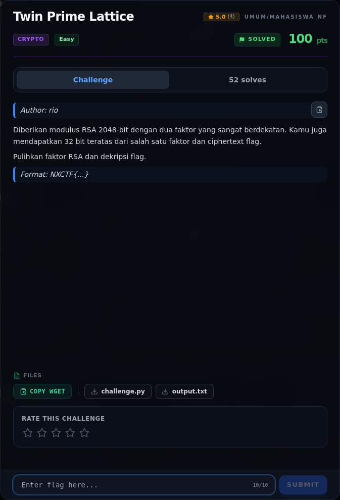
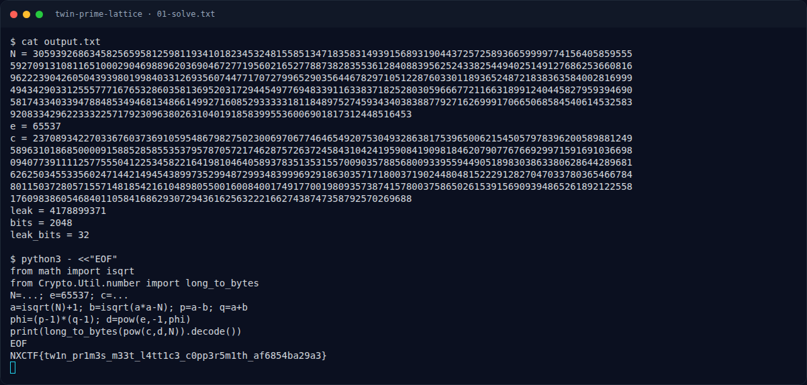

# Twin Prime Lattice

Track Mahasiswa NF · CryptoEasy100 poinVERIFIED

| Field | Nilai |
|---|---|
| Event | `umum/mahasiswa_nf` |
| Kategori | `Crypto` |
| Author | `rio` |
| Difficulty | `Easy` |
| Poin (snapshot) | `100` |
| Flag | `NXCTF{tw1n_pr1m3s_m33t_l4tt1c3_c0pp3r5m1th_af6854ba29a3}` |
| Status | `VERIFIED` |
| Snapshot | 2026-11-13 |

[← Kembali ke Index](index.md)

## TL;DR

- **Flag:** `NXCTF{tw1n_pr1m3s_m33t_l4tt1c3_c0pp3r5m1th_af6854ba29a3}`
- **Baca langkah lengkap:** [Cara Mendapatkan Flag](75-twin-prime-lattice-02-cara-mendapatkan-flag.md)

## Challenge Brief (platform)

*Challenge brief asli di platform NFX CTF 2026.*

## Alur & Titik Penting

| # | Langkah | Titik penting | Buka |
|---:|---|---|---|
| 1 | Recon | `output.txt`: N, e, c. | [Buka](75-twin-prime-lattice-01-recon.md) |
| 2 | Cara Mendapatkan Flag | Fermat factorization, bukan lattice. | [Buka](75-twin-prime-lattice-02-cara-mendapatkan-flag.md) |
| 3 | Flag | NXCTF{tw1n_pr1m3s_m33t_l4tt1c3_c0pp3r5m1th_af6854ba29a3} | [Buka](75-twin-prime-lattice-03-flag.md) |
| 4 | Bukti / Evidence | arsip screenshot dan transkrip | [Buka](75-twin-prime-lattice-04-bukti-evidence.md) |
| 5 | Referensi | Fermat factorization, RSA twin primes. | [Buka](75-twin-prime-lattice-05-referensi.md) |

## Cerita singkat

Dua faktor RSA berdekatan. Fermat dari `isqrt(N)` memulihkan `p` dan `q`, lalu ciphertext didekripsi biasa. Prefix flag `NXCTF`.

Pratinjau evidence. Buka halaman <a href="75-twin-prime-lattice-04-bukti-evidence.html">Evidence / Bukti</a> untuk semua screenshot dan transkrip.

## Navigasi Halaman

<a class="nx-page-card" href="75-twin-prime-lattice-01-recon.html"><b>Recon</b>Enumerasi target dan bukti awal</a>
<a class="nx-page-card" href="75-twin-prime-lattice-02-cara-mendapatkan-flag.html"><b>Cara Mendapatkan Flag</b>Flag dan verifikasi platform</a>
<a class="nx-page-card" href="75-twin-prime-lattice-03-flag.html"><b>Flag</b>Flag dan verifikasi platform</a>
<a class="nx-page-card" href="75-twin-prime-lattice-04-bukti-evidence.html"><b>Bukti / Evidence</b>Screenshot, transkrip, dan artefak</a>
<a class="nx-page-card" href="75-twin-prime-lattice-05-referensi.html"><b>Referensi</b>Sumber dan bacaan lanjutan</a>

