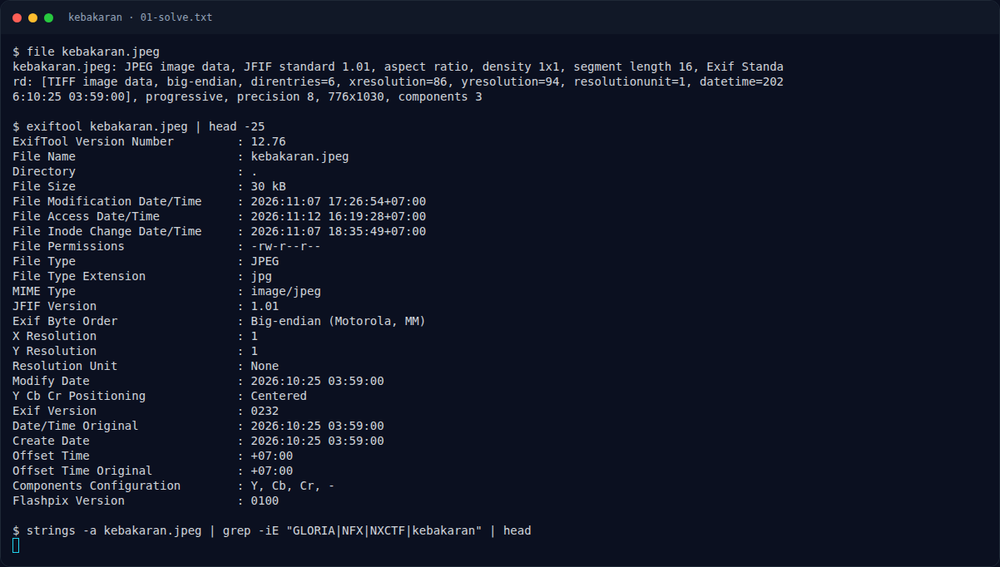

# Kebakaran — Jejak awal

[← Overview](76-kebakaran.md) · [Index](index.md)

> **Langkah 1/5.** Foto malam 25 Oktober 2026 03:59. Papan toko tidak terbaca.
>
> **Berikutnya:** [Cara Mendapatkan Flag](76-kebakaran-02-cara-mendapatkan-flag.md)

```bash
exiftool kebakaran.jpeg
```

```text
Date/Time Original : 2026:10:25 03:59:00
Offset Time        : +07:00
```

Brief meminta tiga nama usaha dari Google Street View sebelum kejadian: urut alfabet, tanpa kata "Toko", tanpa spasi, huruf kapital, dipisah `_`. Foto sendiri hanya gang malam, tembok bergrafiti, dan api di ujung gang.

### Evidence langkah ini



*Terminal evidence — transkrip langkah — `term-01-solve.png`.*

**Berkas mentah terkait:**

- [`01-solve.txt`](assets/kebakaran/01-solve.txt)
