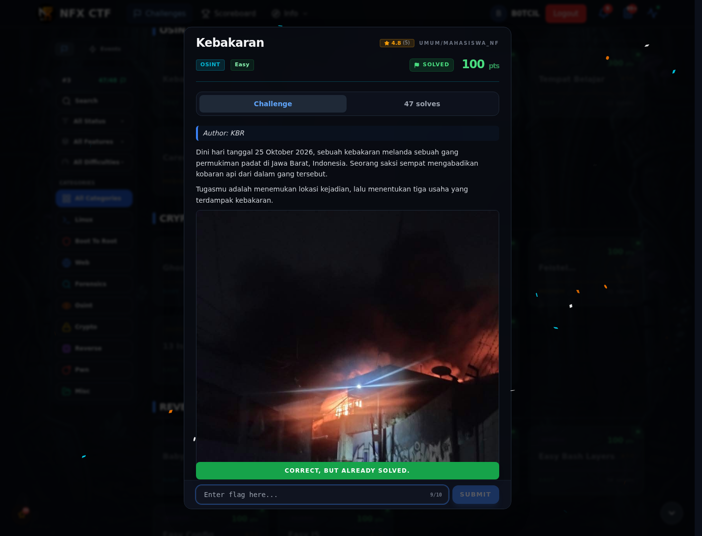

# Kebakaran — Flag & Verifikasi

[← Overview](76-kebakaran.md) · [Index](index.md)

> **Langkah 2/5 — Cara Mendapatkan Flag.** Cara Mendapatkan Flag
>
> **Titik penting:** NXCTF{GLORIA_SETIABAKTI_SINARHARAPAN}
>
> **Berikutnya:** [Flag](76-kebakaran-03-flag.md)

> **Flag:** `NXCTF{GLORIA_SETIABAKTI_SINARHARAPAN}`
> **Status:** `VERIFIED`

1. Cari lokasi kejadian dari foto/berita.
2. Identifikasi gedung dan perusahaan di dalamnya.
3. Rangkai nama perusahaan/entitas menjadi flag.

### Bukti submit di platform

*Submit flag di platform: `CORRECT, BUT ALREADY SOLVED.`*

> **Bukti submit:** screenshot form challenge di atas menampilkan `CORRECT, BUT ALREADY SOLVED.`
