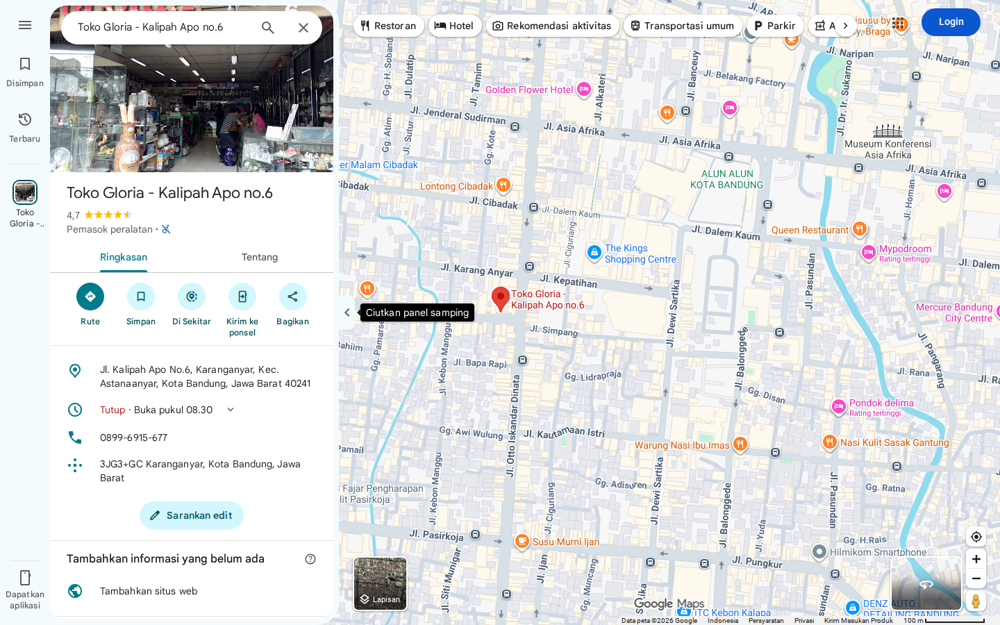
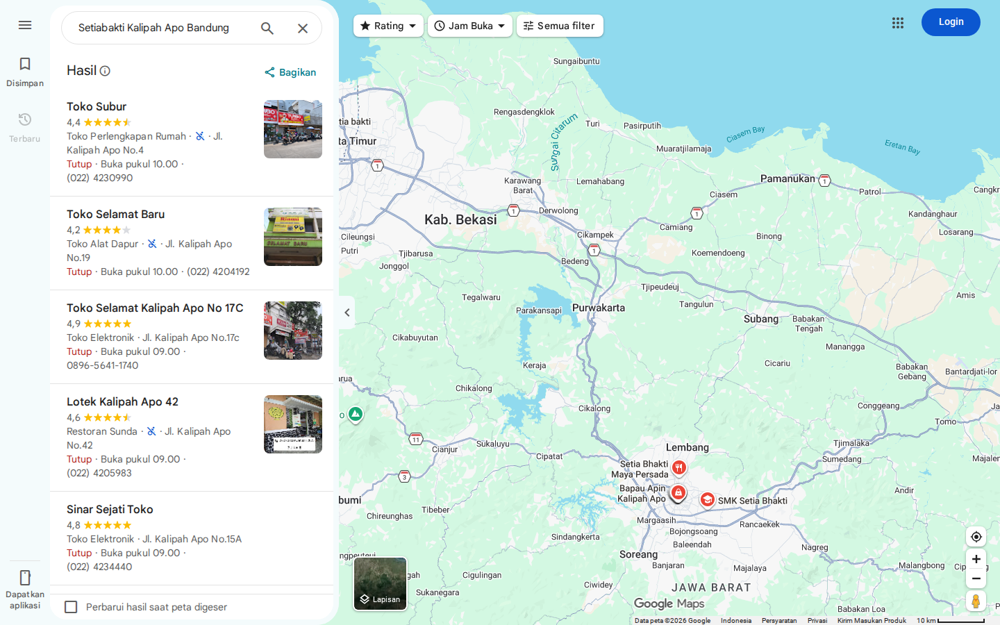
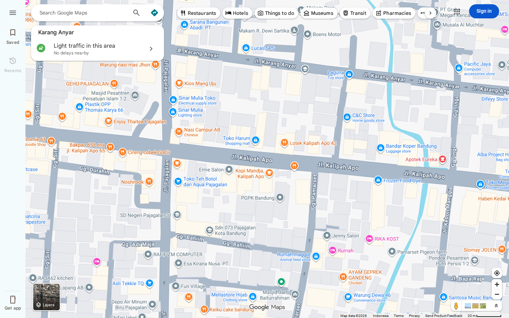
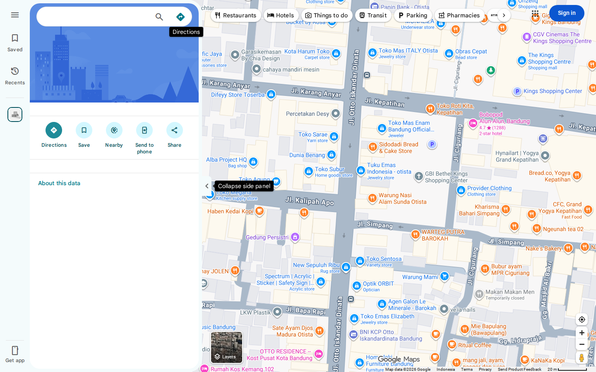
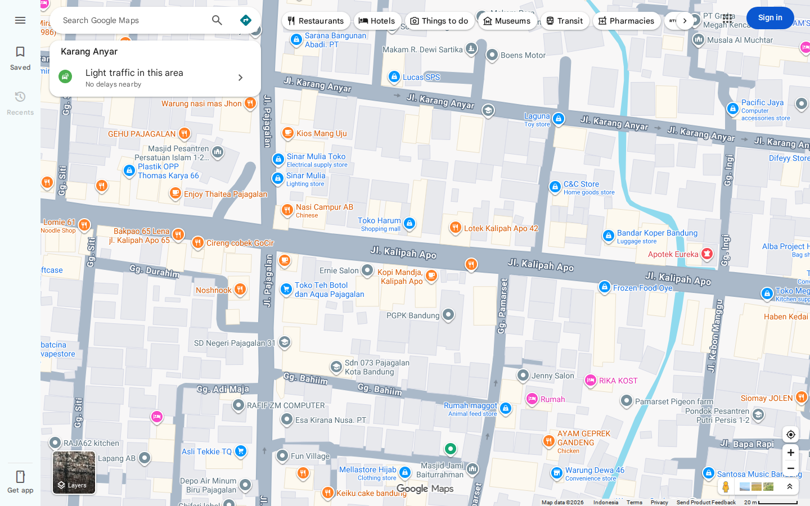
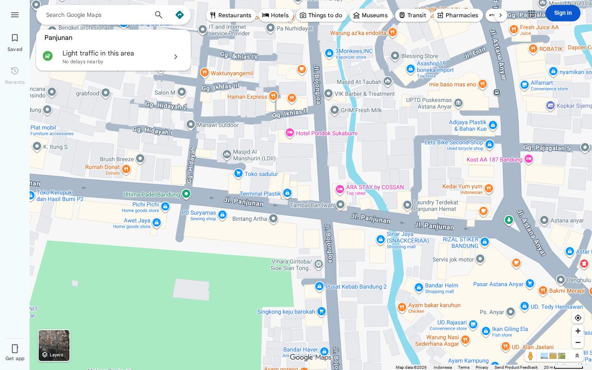

# Kebakaran — Cara mendapatkan flag

[← Overview](76-kebakaran.md) · [Index](index.md)

> **Langkah 2/5.** Lokasi: **Kalipah Apo, Karang Anyar, Astanaanyar, Bandung**.
>
> **Berikutnya:** [Flag](76-kebakaran-03-flag.md)

## 1. Petunjuk

Brief menyebut kebakaran dini hari **25 Oktober 2026** di **gang permukiman
padat di Jawa Barat**. Foto `kebakaran.jpeg` tidak menyimpan GPS; EXIF hanya
memberi waktu.

## 2. Lokasi

Lokasi yang cocok:

```text
Gang Kalipah Apo
-6.9235566, 107.6012945
```

Google Maps:
`https://www.google.com/maps/@-6.9235566,107.6012945,19z`

Tiga usaha di sekitar lokasi:

| Usaha | Alamat / titik | Koordinat |
|---|---|---|
| **Toko Gloria** | Jl. Kalipah Apo No.6, Bandung 40241 | `-6.9236925, 107.603579` |
| **Setiabakti** | Jl./Pasar Kalipah Apo | `-6.9235546, 107.6012793` |
| **Sinar Harapan** | Kec. Astanaanyar | `-6.9299008, 107.5993373` |

### Screenshot Google Maps



*Google Maps place search: Toko Gloria, Kalipah Apo no.6.*



*Google Maps place search: Setiabakti, Kalipah Apo.*



*Google Maps map view kawasan Kalipah Apo. Street View pada titik ini tidak
tersedia saat capture, jadi bukti yang dipakai adalah map view + nama tempat.*

<div class="nx-evidence-grid">
<figure><a href="assets/kebakaran/10-google-maps-gloria.png" target="_blank" rel="noopener"></a><figcaption>Map view — Toko Gloria</figcaption></figure>
<figure><a href="assets/kebakaran/10-google-maps-setiabakti.png" target="_blank" rel="noopener"></a><figcaption>Map view — Setiabakti</figcaption></figure>
<figure><a href="assets/kebakaran/10-google-maps-sinarharapan.png" target="_blank" rel="noopener"></a><figcaption>Map view — Sinar Harapan</figcaption></figure>
</div>

*Tiga map view di sekitar Kalipah Apo. Titik yang dipakai untuk flag adalah
Toko Gloria, Setiabakti, dan Sinar Harapan.*

## 3. Susun flag

Urut alfabetis:

```text
Gloria
Setiabakti
Sinarharapan
```

Buang “Toko”, spasi, dan jadikan kapital:

```text
GLORIA_SETIABAKTI_SINARHARAPAN
```

```text
NXCTF{GLORIA_SETIABAKTI_SINARHARAPAN}
```

Catatan: frame Street View yang membaca papan toko belum tersimpan; yang ada
adalah screenshot Google Maps map view dan place search di atas.
