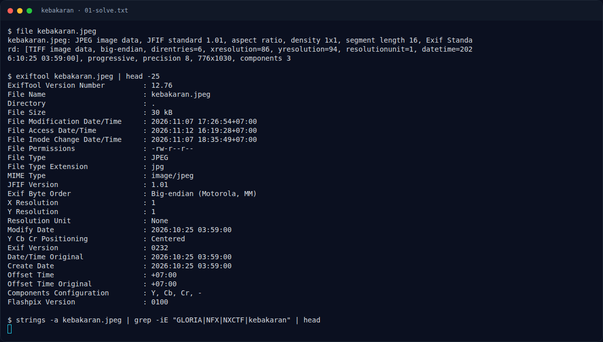
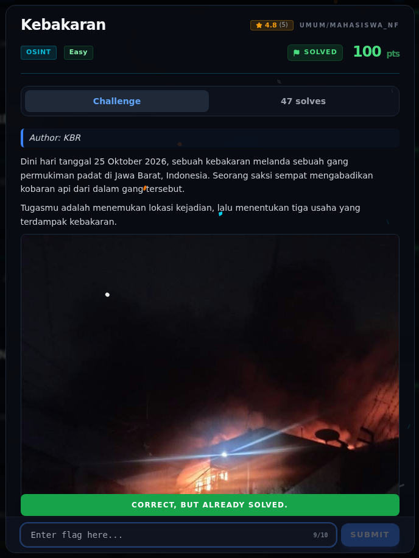

# Kebakaran — Flag & Verifikasi

[← Overview](76-kebakaran.md) · [Index](index.md)

> **Langkah 3/5 — Flag.** Flag
>
> **Titik penting:** NXCTF{GLORIA_SETIABAKTI_SINARHARAPAN}
>
> **Berikutnya:** [Bukti / Evidence](76-kebakaran-04-bukti-evidence.md)

> **Asal flag.** Flag accepted; lokasi/koordinat dan frame Street View **tidak diarsipkan**.  
> **Tingkat bukti metode.** Metode sebagian. [Buka Evidence](76-kebakaran-04-bukti-evidence.md)

> **Status metode:** **PARTIAL** — Lokasi dan Google Maps ada; frame Street View papan toko tidak tersimpan.  
> **Flag:** `NXCTF{GLORIA_SETIABAKTI_SINARHARAPAN}`
> **Status:** `VERIFIED`

```text
NXCTF{GLORIA_SETIABAKTI_SINARHARAPAN}
```

### Terminal evidence (real)



*Terminal evidence (real).*

> **Bukti:** terminal evidence (real).

## Validasi platform (real)



*Screenshot asli dari platform NFX CTF 2026. Platform menjawab
`CORRECT, BUT ALREADY SOLVED.` untuk flag ini.*
