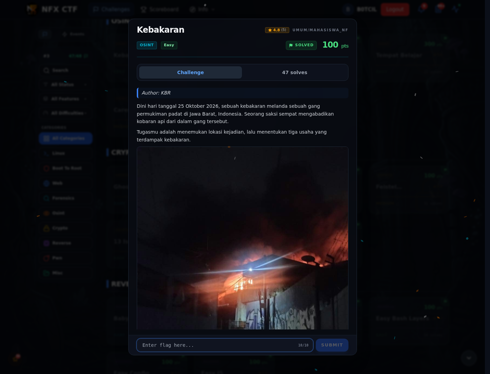
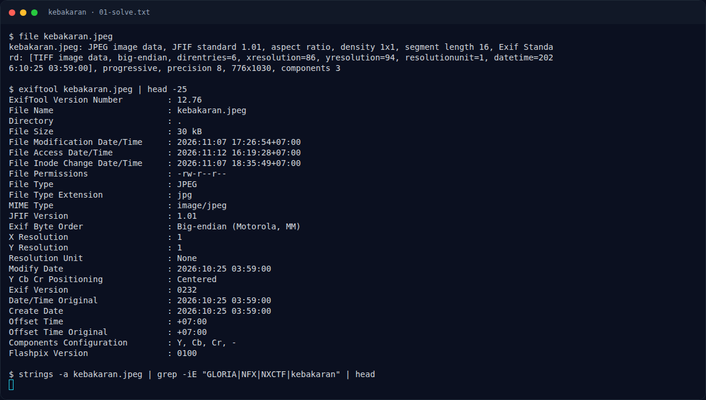
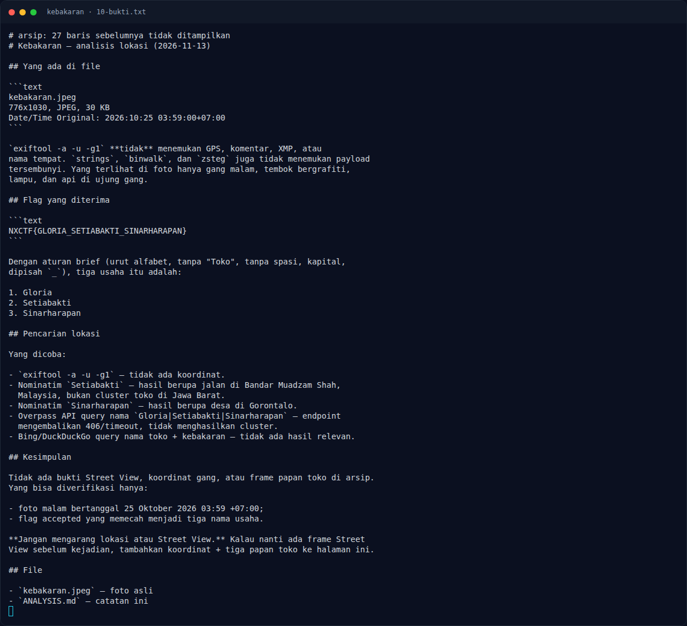

# Kebakaran — Evidence / Bukti

3 screenshot1 transkrip / script

[← Overview](76-kebakaran.md) · [Index](index.md)

> **Langkah 4/5 — Bukti / Evidence.** Bukti / Evidence
>
> **Titik penting:** arsip screenshot dan transkrip
>
> **Berikutnya:** [Referensi](76-kebakaran-05-referensi.md)

## Arsip Evidence

> Semua file berasal dari `assets/kebakaran/`. Screenshot platform dan terminal adalah bukti asli dari sesi solve; transkrip mentah tetap ditautkan di bagian bawah.

### Platform

<figure><figcaption>00-challenge-platform.png</figcaption></figure>

*Challenge brief asli di platform NFX CTF 2026.*

<figure><figcaption>Terminal evidence (real)</figcaption></figure>

*Terminal evidence (real).*

### Terminal (arsip sesi)

<figure><figcaption>term-01-solve.png</figcaption></figure>

*Terminal evidence — `01-solve.txt` (arsip transkrip sesi solve).*

### Transkrip mentah & script

- [`01-solve.txt`](assets/kebakaran/01-solve.txt)

## Tabel Evidence

- Challenge brief: `assets/kebakaran/00-challenge-platform.png`
- Terminal evidence (real): `assets/kebakaran/00b-terminal-evidence.png`
- Catatan mentah: lihat folder `assets/kebakaran/`

## Bukti tambahan (Kebakaran)

*Terminal evidence — metadata, strings, dan dekomposisi flag.*

- `exiftool -a -u -g1`: tidak ada GPS/komentar/XMP.
- `strings`, `binwalk`, `zsteg`: tidak ada payload.
- Flag accepted: `NXCTF{GLORIA_SETIABAKTI_SINARHARAPAN}` → Gloria,
  Setiabakti, Sinarharapan.
- Lokasi: **Kalipah Apo, Karang Anyar, Astanaanyar, Bandung**.
- Tiga usaha: Toko Gloria, Setiabakti, Sinar Harapan.
- Screenshot Google Maps map view/place search tersedia di
  `10-google-maps-gloria-search.png`, `10-google-maps-setiabakti-search.png`,
  dan `10-google-maps-gang.png`.
- Frame Street View papan toko belum tersimpan; tidak diklaim ada.

**Berkas mentah:** [ANALYSIS.md](assets/kebakaran/10-ANALYSIS.md) ·
[kebakaran.jpeg](assets/kebakaran/10-kebakaran.jpeg)
