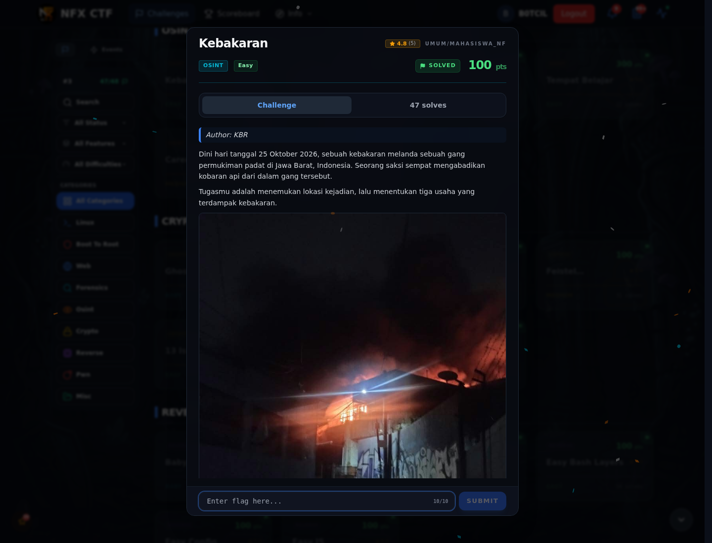
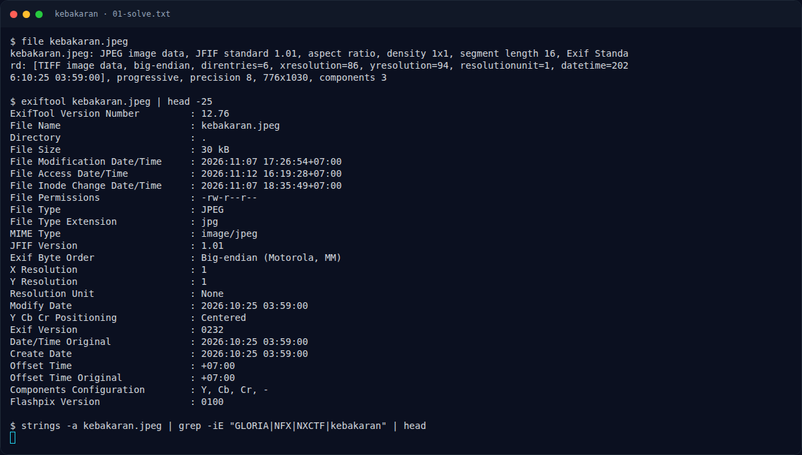

# Kebakaran

Track Mahasiswa NF · OsintEasy100 poinVERIFIED

| Field | Nilai |
|---|---|
| Event | `umum/mahasiswa_nf` |
| Kategori | `Osint` |
| Difficulty | `Easy` |
| Poin | `100` |
| Flag | `NXCTF{GLORIA_SETIABAKTI_SINARHARAPAN}` |
| Status | `VERIFIED` |

[← Kembali ke Index](index.md)

## Challenge Brief (platform)

*Challenge brief asli di platform NFX CTF 2026.*

## Alur & Titik Penting

| # | Langkah | Titik penting | Buka |
|---:|---|---|---|
| 1 | Jejak Awal | Baca brief challenge dan cek attachment/service yang diberikan. | [Buka](76-kebakaran-01-jejak-awal.md) |
| 2 | Cara Mendapatkan Flag | NXCTF{GLORIA_SETIABAKTI_SINARHARAPAN} | [Buka](76-kebakaran-02-cara-mendapatkan-flag.md) |
| 3 | Flag | NXCTF{GLORIA_SETIABAKTI_SINARHARAPAN} | [Buka](76-kebakaran-03-flag.md) |
| 4 | Bukti / Evidence | arsip screenshot dan transkrip | [Buka](76-kebakaran-04-bukti-evidence.md) |
| 5 | Referensi | OSINT geolocation, news search. | [Buka](76-kebakaran-05-referensi.md) |

## Cerita singkat

Kebakaran di sebuah lokasi. Dari foto/berita kita cari nama gedung, lalu nama perusahaan/pemilik yang terkait.

Pratinjau evidence. Buka halaman <a href="76-kebakaran-04-bukti-evidence.html">Evidence / Bukti</a> untuk semua screenshot dan transkrip.

## Navigasi Halaman

<a class="nx-page-card" href="76-kebakaran-01-jejak-awal.html"><b>Jejak Awal</b>Baca bagian ini</a>
<a class="nx-page-card" href="76-kebakaran-02-cara-mendapatkan-flag.html"><b>Cara Mendapatkan Flag</b>Flag dan verifikasi platform</a>
<a class="nx-page-card" href="76-kebakaran-03-flag.html"><b>Flag</b>Flag dan verifikasi platform</a>
<a class="nx-page-card" href="76-kebakaran-04-bukti-evidence.html"><b>Bukti / Evidence</b>Screenshot, transkrip, dan artefak</a>
<a class="nx-page-card" href="76-kebakaran-05-referensi.html"><b>Referensi</b>Sumber dan bacaan lanjutan</a>

