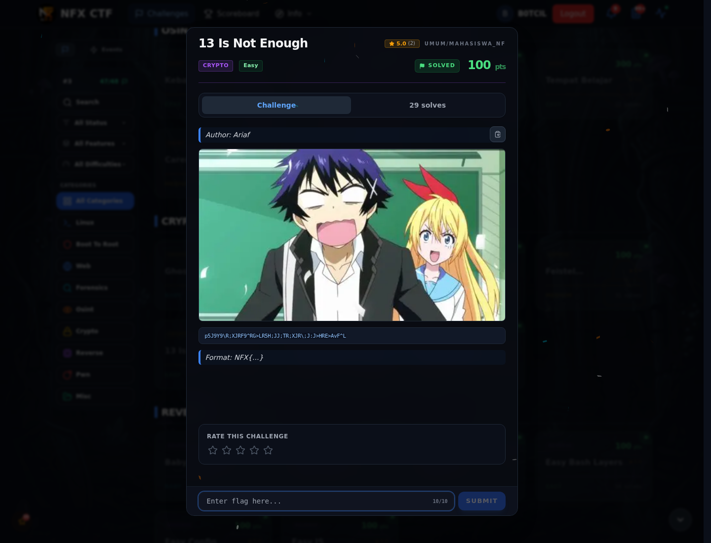

# 13 Is Not Enough — Recon

[← Overview](77-13-is-not-enough.md) · [Index](index.md)

> **Langkah 1/5 — Recon.** Satu-satunya data adalah ciphertext di brief;
> tidak ada attachment.
>
> **Titik penting:** `p5J9Y9\R;XJRF9^RG>LR5H;JJ;TR;XJR\;J:J>HRE>AvF^L`
>
> **Berikutnya:** [Cara Mendapatkan Flag](77-13-is-not-enough-02-cara-mendapatkan-flag.md)

## Yang dikumpulkan dari brief

| Item | Nilai |
|---|---|
| Judul | `13 Is Not Enough` |
| Author | `Ariaf` |
| Kategori | `Crypto` |
| Difficulty | `Easy` |
| Format flag | `NFX{...}` |
| Attachment | tidak ada |
| Service | tidak ada |

Ciphertext:

```text
p5J9Y9\R;XJRF9^RG>LR5H;JJ;TR;XJR\;J:J>HRE>AvF^L
```

## Observasi awal

- Panjang ciphertext **47 karakter** — sama dengan panjang flag yang akhirnya
  diterima.
- Isinya campuran huruf besar/kecil, digit, dan simbol. Ini bukan Base64
  (ada `\`, `^`, `>`, `;`) dan bukan hex.
- Judul “13 Is Not Enough” memberi dua petunjuk: **ROT13** dan angka **13**
  sebagai kemungkinan key.
- Karena format flag `NFX{...}`, kita punya known-plaintext minimum:
  `N`, `F`, `X`, `{` di awal dan `}` di akhir.

## Rencana uji

1. Coba ROT13 langsung (judul).
2. Kalau gagal, coba XOR dengan `13` (`0x0D`), karena 13 juga bisa jadi key.
3. Perhatikan posisi `{`/`}`; kalau perlu, reverse string.
4. Setelah bentuk flag muncul, koreksi digit sesuai pesan flag.

Semua langkah dan outputnya ada di halaman
[Cara Mendapatkan Flag](77-13-is-not-enough-02-cara-mendapatkan-flag.md).

### Evidence langkah ini



*Challenge brief asli di platform NFX CTF 2026.*
