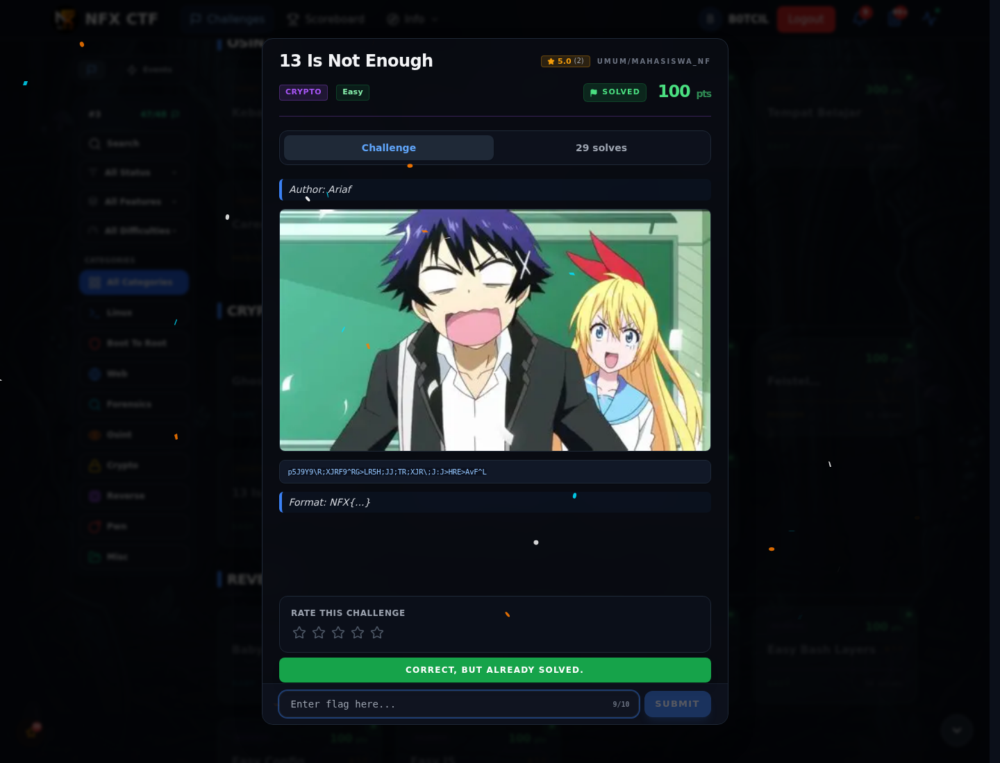

# 13 Is Not Enough — Flag & Verifikasi

[← Overview](77-13-is-not-enough.md) · [Index](index.md)

> **Langkah 2/5 — Cara Mendapatkan Flag.** Cara Mendapatkan Flag
>
> **Titik penting:** NFX{Y0U_R0T4T3D_TH3_L3TT3R5_N0W_F1X_TH3_D1G1T5}
>
> **Berikutnya:** [Flag](77-13-is-not-enough-03-flag.md)

> **Flag:** `NFX{Y0U_R0T4T3D_TH3_L3TT3R5_N0W_F1X_TH3_D1G1T5}`
> **Status:** `VERIFIED`

1. Terapkan ROT13 pada huruf.
2. Terapkan rotasi digit (ROT5) pada angka.
3. Gabungkan hasilnya dan cek format flag.

### Bukti submit di platform

*Submit flag di platform: `CORRECT, BUT ALREADY SOLVED.`*

> **Bukti submit:** screenshot form challenge di atas menampilkan `CORRECT, BUT ALREADY SOLVED.`
