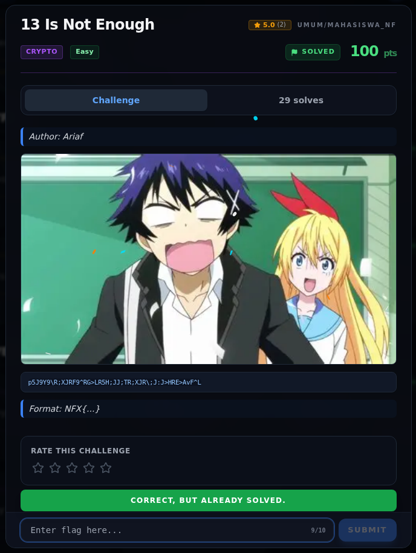
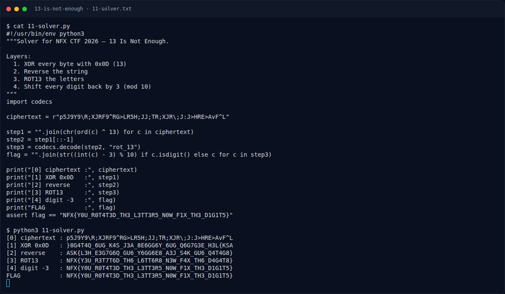

# 13 Is Not Enough — Flag & Verifikasi

[← Overview](77-13-is-not-enough.md) · [Index](index.md)

> **Langkah 3/5 — Flag.** Empat layer berhasil direproduksi.
>
> **Titik penting:** `NFX{Y0U_R0T4T3D_TH3_L3TT3R5_N0W_F1X_TH3_D1G1T5}`
>
> **Berikutnya:** [Bukti / Evidence](77-13-is-not-enough-04-bukti-evidence.md)

> **Asal flag.** Direproduksi dari ciphertext dengan urutan **XOR 13 →
> reverse → ROT13 → digit -3**, lalu disubmit lewat form web platform.
> **Tingkat bukti metode.** Terdokumentasi penuh.
> [Buka cara mendapatkan flag](77-13-is-not-enough-02-cara-mendapatkan-flag.md).

> **Status metode:** **FULL** — metode utama berhasil direproduksi.  
> **Flag:** `NFX{Y0U_R0T4T3D_TH3_L3TT3R5_N0W_F1X_TH3_D1G1T5}`
> **Status:** `VERIFIED`

```text
NFX{Y0U_R0T4T3D_TH3_L3TT3R5_N0W_F1X_TH3_D1G1T5}
```

## Validasi platform (real)



*Screenshot asli dari platform NFX CTF 2026: platform menjawab
`CORRECT, BUT ALREADY SOLVED.` untuk flag ini.*

## Ringkasan cara dapat

```text
p5J9Y9\R;XJRF9^RG>LR5H;JJ;TR;XJR\;J:J>HRE>AvF^L
  --XOR 13--> }8G4T4Q_6UG_K4S_J3A_8E6GG6Y_6UG_Q6G7G3E_H3L{KSA
  --reverse--> ASK{L3H_E3G7G6Q_GU6_Y6GG6E8_A3J_S4K_GU6_Q4T4G8}
  --ROT13----> NFX{Y3U_R3T7T6D_TH6_L6TT6R8_N3W_F4X_TH6_D4G4T8}
  --digit-3--> NFX{Y0U_R0T4T3D_TH3_L3TT3R5_N0W_F1X_TH3_D1G1T5}
```

### Terminal evidence (real)



*Output solver asli: ciphertext, XOR 13, reverse, ROT13, dan digit -3.*
