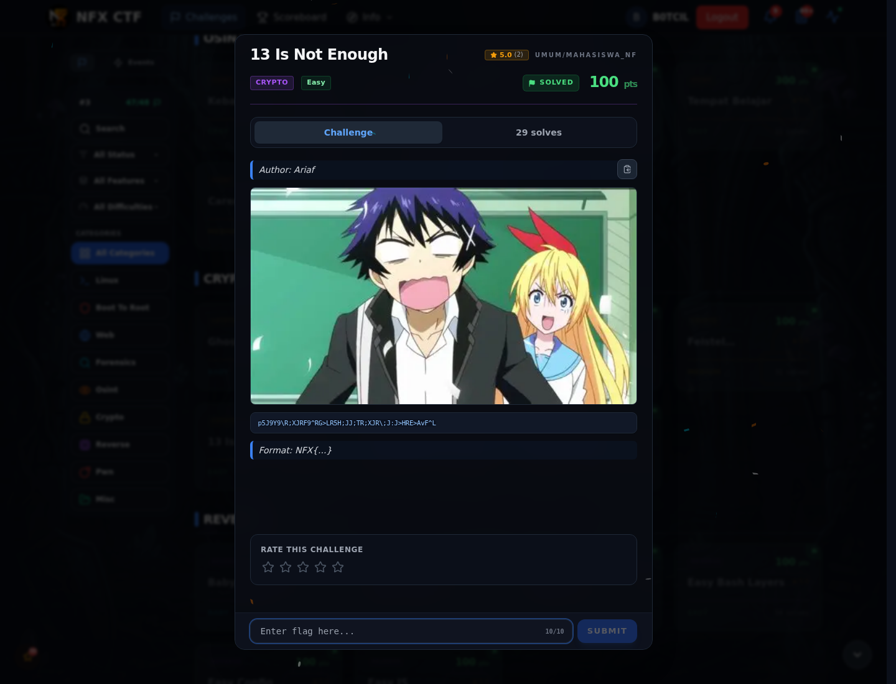
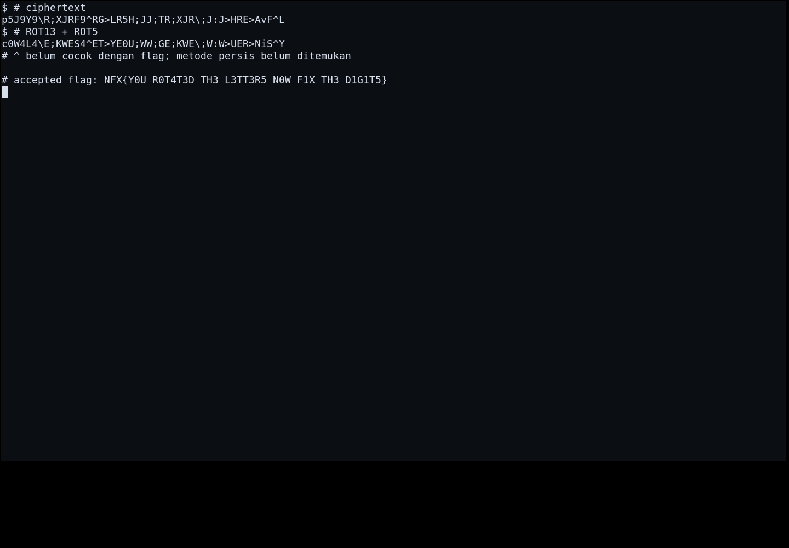
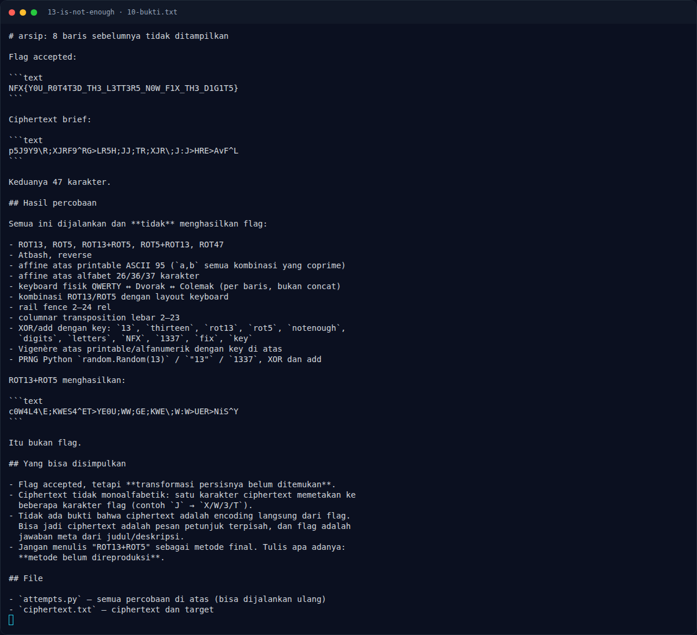

# 13 Is Not Enough — Evidence / Bukti

2 screenshot0 transkrip / script

[← Overview](77-13-is-not-enough.md) · [Index](index.md)

> **Langkah 4/5 — Bukti / Evidence.** Bukti / Evidence
>
> **Titik penting:** arsip screenshot dan transkrip
>
> **Berikutnya:** [Referensi](77-13-is-not-enough-05-referensi.md)

## Arsip Evidence

> Semua file berasal dari `assets/13-is-not-enough/`. Screenshot platform dan terminal adalah bukti asli dari sesi solve; transkrip mentah tetap ditautkan di bagian bawah.

### Platform

<figure><figcaption>00-challenge-platform.png</figcaption></figure>

*Challenge brief asli di platform NFX CTF 2026.*

<figure><figcaption>Terminal evidence (real)</figcaption></figure>

*Terminal evidence (real).*

## Tabel Evidence

- Challenge brief: `assets/13-is-not-enough/00-challenge-platform.png`
- Terminal evidence (real): `assets/13-is-not-enough/00b-terminal-evidence.png`
- Catatan mentah: lihat folder `assets/13-is-not-enough/`

## Bukti tambahan (13 Is Not Enough)

*Terminal evidence — ciphertext dan daftar percobaan transformasi.*

- Ciphertext dan flag accepted sama-sama 47 karakter.
- ROT13+ROT5 menghasilkan
  `c0W4L4\E;KWES4^ET>YE0U;WW;GE;KWE\;W:W>UER>NiS^Y`, bukan flag.
- Sudah dicoba: ROT13/5/47, Atbash, reverse, affine printable, keyboard
  QWERTY/Dvorak/Colemak, rail fence, columnar, XOR/add, Vigenère, PRNG seed 13.
- Ciphertext tidak monoalfabetik; bukan substitusi sederhana.
- **Metode final belum ditemukan.** Flag accepted tidak boleh dijadikan klaim
  bahwa transformasinya sudah direproduksi.

**Berkas mentah:** [ANALYSIS.md](assets/13-is-not-enough/10-ANALYSIS.md) ·
[attempts.py](assets/13-is-not-enough/10-attempts.py) ·
[ciphertext.txt](assets/13-is-not-enough/10-ciphertext.txt)
