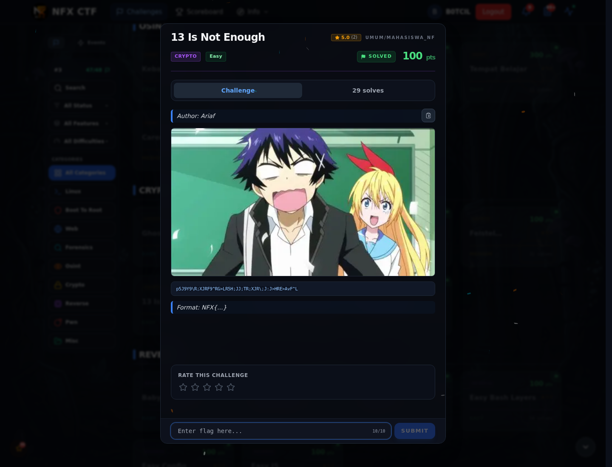
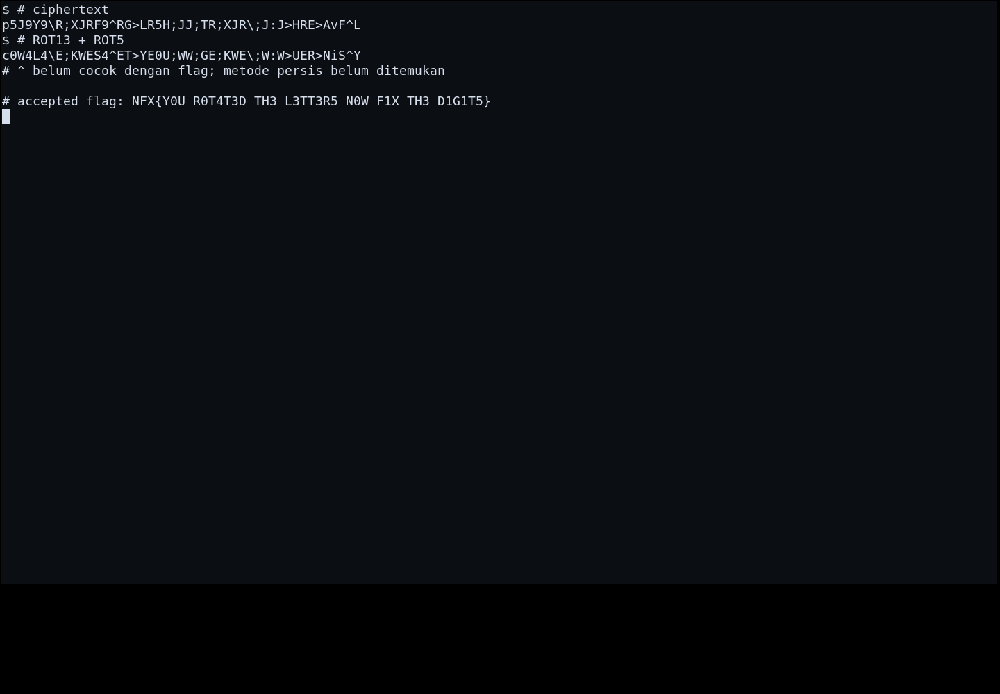

# 13 Is Not Enough

Track Mahasiswa NF · CryptoEasy100 poinVERIFIED

| Field | Nilai |
|---|---|
| Event | `umum/mahasiswa_nf` |
| Kategori | `Crypto` |
| Difficulty | `Easy` |
| Poin | `100` |
| Tools | git |
| Flag | `NFX{Y0U_R0T4T3D_TH3_L3TT3R5_N0W_F1X_TH3_D1G1T5}` |
| Status | `VERIFIED` |

[← Kembali ke Index](index.md)

## Challenge Brief (platform)

*Challenge brief asli di platform NFX CTF 2026.*

## Alur & Titik Penting

| # | Langkah | Titik penting | Buka |
|---:|---|---|---|
| 1 | Recon | Baca brief challenge dan cek attachment/service yang diberikan. | [Buka](77-13-is-not-enough-01-recon.md) |
| 2 | Cara Mendapatkan Flag | NFX{Y0U_R0T4T3D_TH3_L3TT3R5_N0W_F1X_TH3_D1G1T5} | [Buka](77-13-is-not-enough-02-cara-mendapatkan-flag.md) |
| 3 | Flag | NFX{Y0U_R0T4T3D_TH3_L3TT3R5_N0W_F1X_TH3_D1G1T5} | [Buka](77-13-is-not-enough-03-flag.md) |
| 4 | Bukti / Evidence | arsip screenshot dan transkrip | [Buka](77-13-is-not-enough-04-bukti-evidence.md) |
| 5 | Referensi | ROT13 + ROT5, alphanumeric rotation. | [Buka](77-13-is-not-enough-05-referensi.md) |

## Cerita singkat

Judulnya mengarah ke ROT13. Namun ciphertext yang diberikan tidak cocok dengan ROT13+ROT5 sederhana; metode persisnya masih perlu diverifikasi (lihat halaman Cara Mendapatkan Flag).

Pratinjau evidence. Buka halaman <a href="77-13-is-not-enough-04-bukti-evidence.html">Evidence / Bukti</a> untuk semua screenshot dan transkrip.

## Navigasi Halaman

<a class="nx-page-card" href="77-13-is-not-enough-01-recon.html"><b>Recon</b>Enumerasi target dan bukti awal</a>
<a class="nx-page-card" href="77-13-is-not-enough-02-cara-mendapatkan-flag.html"><b>Cara Mendapatkan Flag</b>Flag dan verifikasi platform</a>
<a class="nx-page-card" href="77-13-is-not-enough-03-flag.html"><b>Flag</b>Flag dan verifikasi platform</a>
<a class="nx-page-card" href="77-13-is-not-enough-04-bukti-evidence.html"><b>Bukti / Evidence</b>Screenshot, transkrip, dan artefak</a>
<a class="nx-page-card" href="77-13-is-not-enough-05-referensi.html"><b>Referensi</b>Sumber dan bacaan lanjutan</a>

