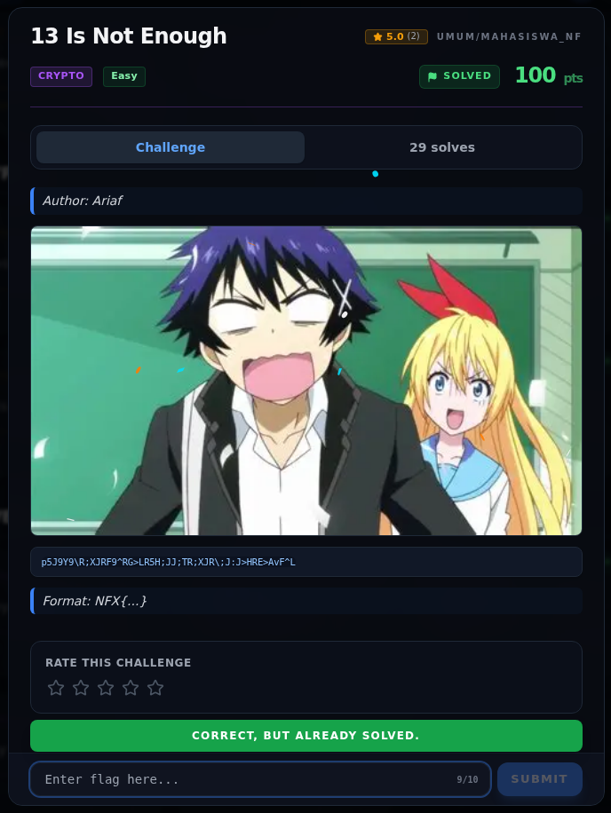

# 13 Is Not Enough

Track Mahasiswa NF · CryptoEasy100 poinVERIFIED

| Field | Nilai |
|---|---|
| Event | `umum/mahasiswa_nf` |
| Kategori | `Crypto` |
| Author | `Ariaf` |
| Difficulty | `Easy` |
| Poin | `100` |
| Tools | `python3`, `codecs` |
| Flag | `NFX{Y0U_R0T4T3D_TH3_L3TT3R5_N0W_F1X_TH3_D1G1T5}` |
| Status | `VERIFIED` |
[← Kembali ke Index](index.md)

## TL;DR

- **Flag:** `NFX{Y0U_R0T4T3D_TH3_L3TT3R5_N0W_F1X_TH3_D1G1T5}`
- **Baca langkah lengkap:** [Cara Mendapatkan Flag](77-13-is-not-enough-02-cara-mendapatkan-flag.md)

## Challenge Brief (platform)

*Challenge brief asli di platform NFX CTF 2026.*

## Alur & Titik Penting

| # | Langkah | Titik penting | Buka |
|---:|---|---|---|
| 1 | Recon | ciphertext 47 karakter, judul mengarah ke 13/ROT13 | [Buka](77-13-is-not-enough-01-recon.md) |
| 2 | Cara Mendapatkan Flag | XOR 13 → reverse → ROT13 → digit -3 | [Buka](77-13-is-not-enough-02-cara-mendapatkan-flag.md) |
| 3 | Flag | `NFX{Y0U_R0T4T3D_TH3_L3TT3R5_N0W_F1X_TH3_D1G1T5}` | [Buka](77-13-is-not-enough-03-flag.md) |
| 4 | Bukti / Evidence | screenshot platform + output solver | [Buka](77-13-is-not-enough-04-bukti-evidence.md) |
| 5 | Referensi | XOR, reverse, ROT13, digit rotation | [Buka](77-13-is-not-enough-05-referensi.md) |

## Cerita singkat

Judulnya “13 Is Not Enough” dan ciphertext-nya 47 karakter. ROT13 saja tidak
cukup. Setelah dicoba, ciphertext harus di-**XOR 13** dulu, lalu
di-**reverse**, baru di-**ROT13**. Hasilnya sudah berbentuk flag, tetapi
digitnya masih salah; flag sendiri memberi tahu “now fix the digits”.
Digit yang tersisa digeser **-3 mod 10**, dan flag final diterima platform.

Validasi platform: <code>CORRECT, BUT ALREADY SOLVED.</code> Buka halaman <a href="77-13-is-not-enough-03-flag.html">Flag</a> untuk detail.

## Navigasi Halaman

<a class="nx-page-card" href="77-13-is-not-enough-01-recon.html"><b>Recon</b>Enumerasi target dan bukti awal</a>
<a class="nx-page-card" href="77-13-is-not-enough-02-cara-mendapatkan-flag.html"><b>Cara Mendapatkan Flag</b>Empat layer transformasi</a>
<a class="nx-page-card" href="77-13-is-not-enough-03-flag.html"><b>Flag</b>Flag dan validasi platform</a>
<a class="nx-page-card" href="77-13-is-not-enough-04-bukti-evidence.html"><b>Bukti / Evidence</b>Screenshot, transkrip, dan artefak</a>
<a class="nx-page-card" href="77-13-is-not-enough-05-referensi.html"><b>Referensi</b>Sumber dan bacaan lanjutan</a>

