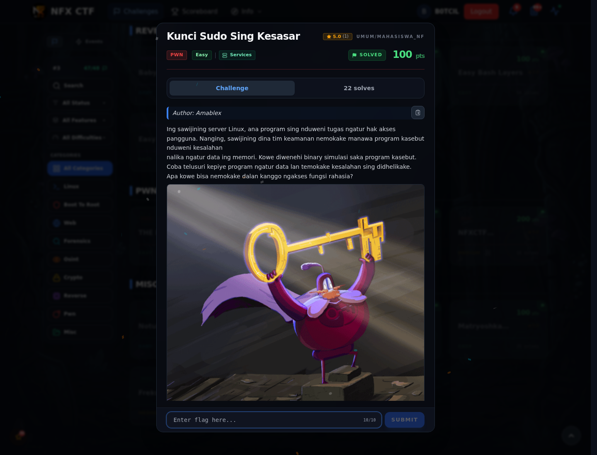

# Kunci Sudo Sing Kesasar — Recon

[← Overview](78-kunci-sudo-sing-kesasar.md) · [Index](index.md)

> **Langkah 1/5 — Recon.** Binary ada di `KunciSudoSingKesasar.zip`, ELF 64-bit, non-PIE, tidak di-strip.
>
> **Titik penting:** `peserta/kunci`, rule harus diawali `ALL`.
>
> **Berikutnya:** [Cara Mendapatkan Flag](78-kunci-sudo-sing-kesasar-02-cara-mendapatkan-flag.md)

```bash
unzip KunciSudoSingKesasar.zip
file peserta/kunci
strings -n 5 peserta/kunci | grep -E 'flag|sudo|ALL'
```

Ini bukan "memory leak token". Parser rule dan struct akses dijelaskan di halaman berikutnya.

### Evidence langkah ini



*Challenge brief asli di platform NFX CTF 2026.*
