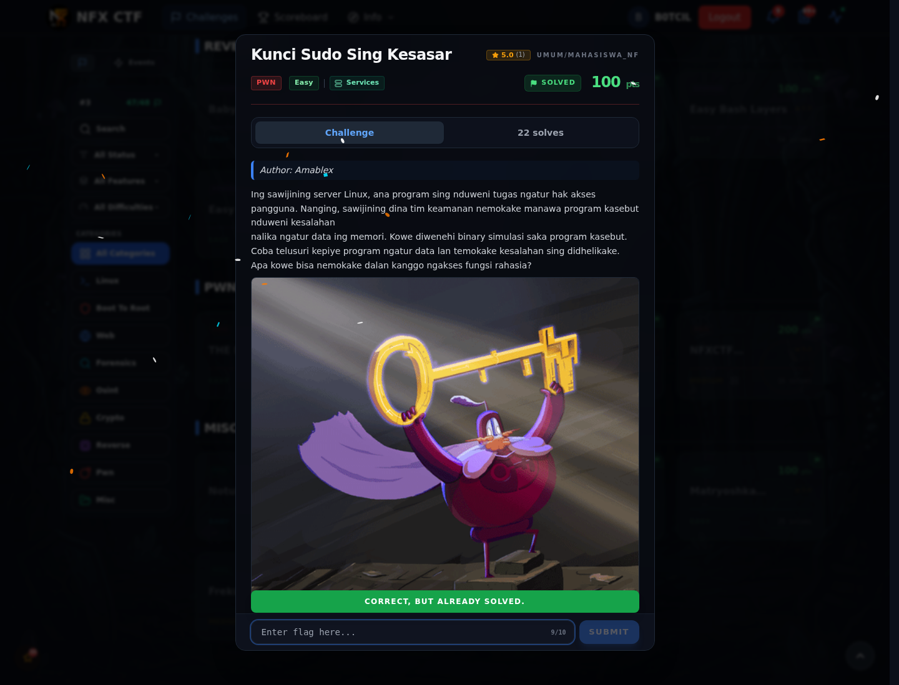

# Kunci Sudo Sing Kesasar — Flag & Verifikasi

[← Overview](78-kunci-sudo-sing-kesasar.md) · [Index](index.md)

> **Langkah 2/5 — Cara Mendapatkan Flag.** Cara Mendapatkan Flag
>
> **Titik penting:** NFX{Wh33W0kTh3Tok-k}
>
> **Berikutnya:** [Flag](78-kunci-sudo-sing-kesasar-03-flag.md)

> **Flag:** `NFX{Wh33W0kTh3Tok-k}`
> **Status:** `VERIFIED`

1. Cek binary dan jalankan.
2. Cari token yang bocor di output/memory.
3. Kirim token ke fungsi rahasia untuk mendapatkan flag.

### Bukti submit di platform

*Submit flag di platform: `CORRECT, BUT ALREADY SOLVED.`*

> **Bukti submit:** screenshot form challenge di atas menampilkan `CORRECT, BUT ALREADY SOLVED.`
