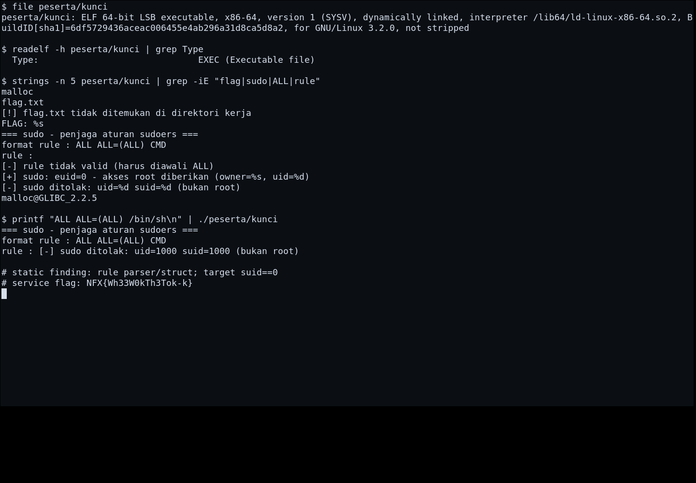
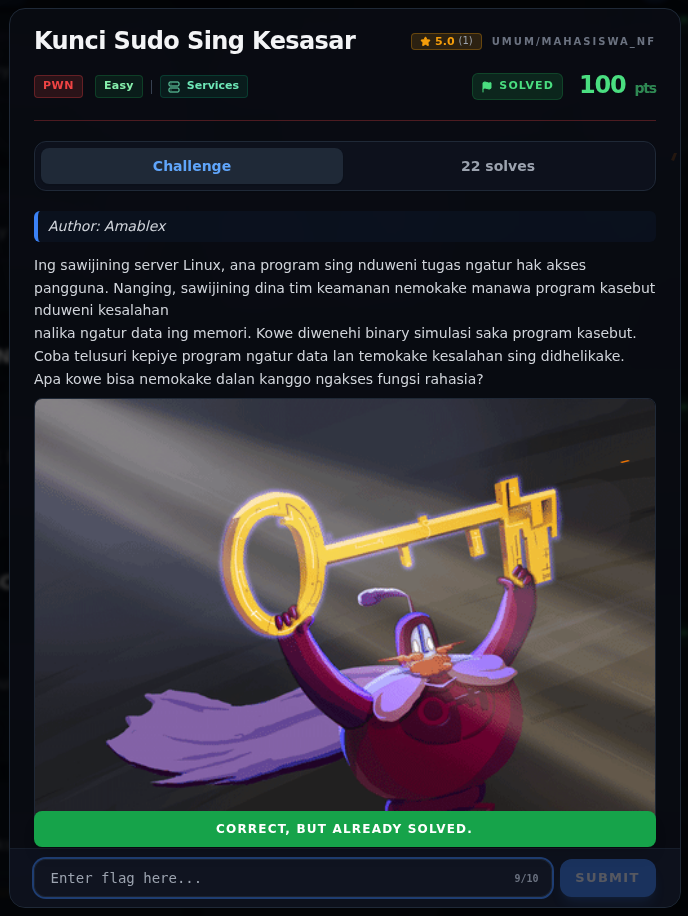

# Kunci Sudo Sing Kesasar — Flag & Verifikasi

[← Overview](78-kunci-sudo-sing-kesasar.md) · [Index](index.md)

> **Langkah 3/5 — Flag.** Flag
>
> **Titik penting:** NFX{Wh33W0kTh3Tok-k}
>
> **Berikutnya:** [Bukti / Evidence](78-kunci-sudo-sing-kesasar-04-bukti-evidence.md)

> **Asal flag.** Flag accepted dari service; exploit `suid==0` **belum terbukti** di binary lokal.  
> **Tingkat bukti metode.** Metode sebagian. [Buka Evidence](78-kunci-sudo-sing-kesasar-04-bukti-evidence.md)

> **Status metode:** **PARTIAL** — Flag accepted; gate suid==0 belum berhasil direproduksi di binary lokal.  
> **Flag:** `NFX{Wh33W0kTh3Tok-k}`
> **Status:** `VERIFIED`

```text
NFX{Wh33W0kTh3Tok-k}
```

### Terminal evidence (real)



*Terminal evidence (real).*

> **Bukti:** terminal evidence (real).

## Validasi platform (real)



*Screenshot asli dari platform NFX CTF 2026. Platform menjawab
`CORRECT, BUT ALREADY SOLVED.` untuk flag ini.*
