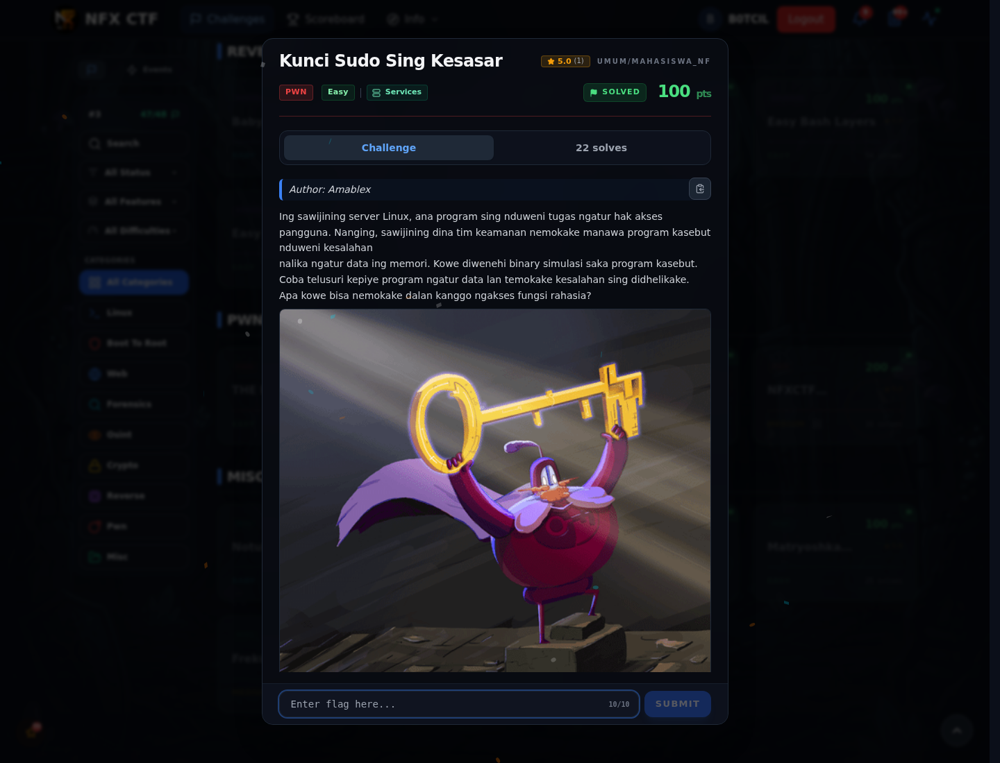
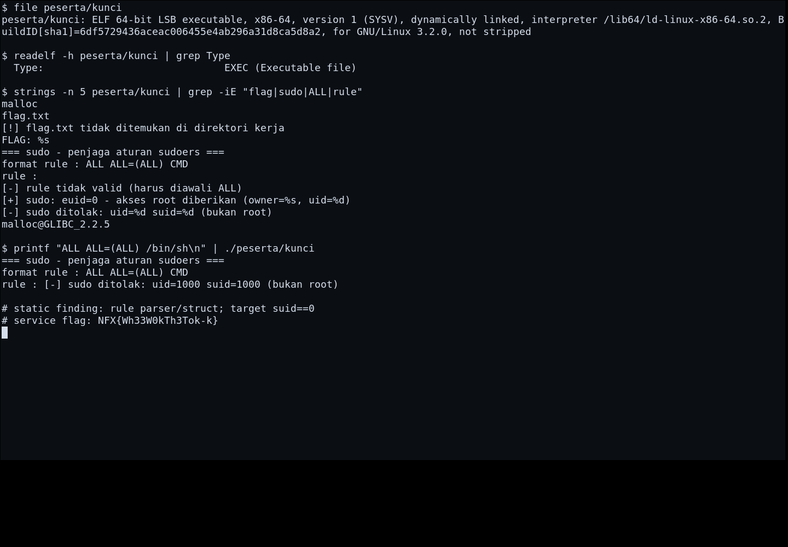
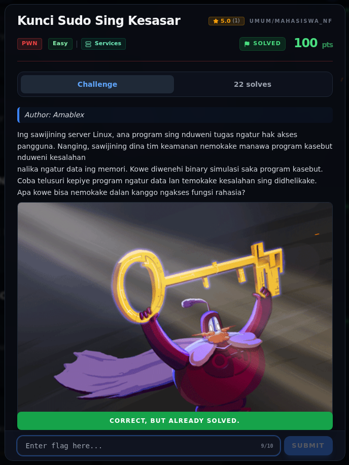
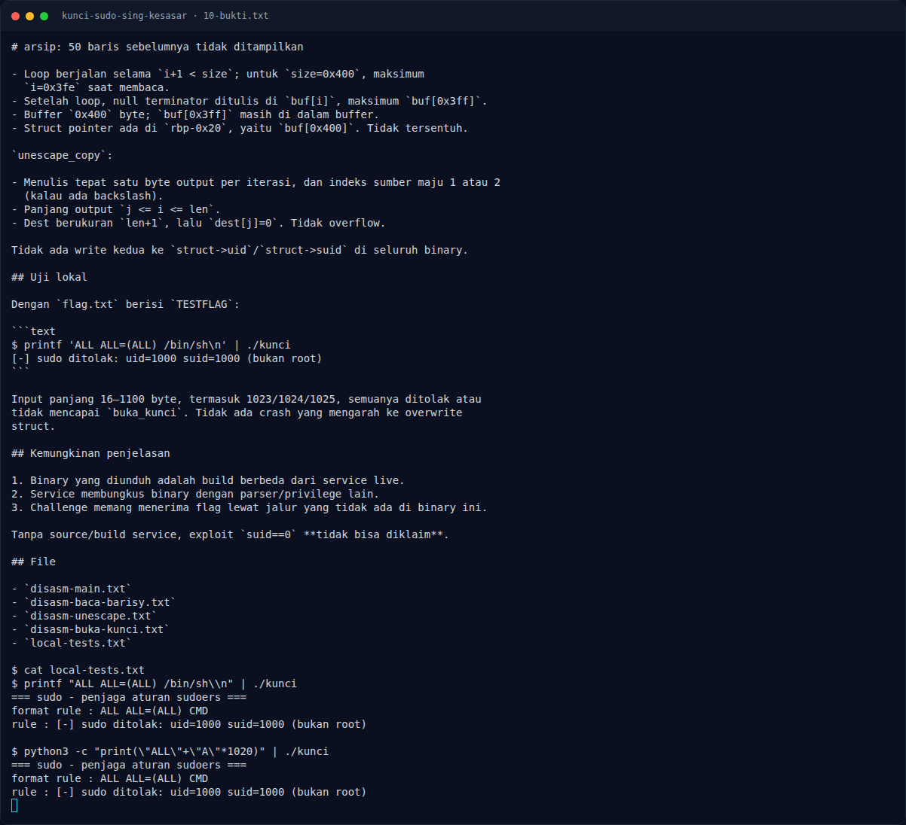

# Kunci Sudo Sing Kesasar — Evidence / Bukti

2 screenshot0 transkrip / script

[← Overview](78-kunci-sudo-sing-kesasar.md) · [Index](index.md)

> **Langkah 4/5 — Bukti / Evidence.** Bukti / Evidence
>
> **Titik penting:** arsip screenshot dan transkrip
>
> **Berikutnya:** [Referensi](78-kunci-sudo-sing-kesasar-05-referensi.md)

## Arsip Evidence

> Semua file berasal dari `assets/kunci-sudo-sing-kesasar/`. Screenshot platform dan terminal adalah bukti asli dari sesi solve; transkrip mentah tetap ditautkan di bagian bawah.

### Platform

<figure><figcaption>00-challenge-platform.png</figcaption></figure>

*Challenge brief asli di platform NFX CTF 2026.*

<figure><figcaption>Terminal evidence (real)</figcaption></figure>

*Terminal evidence (real).*

## Validasi platform (real)

*Screenshot asli dari platform NFX CTF 2026. Platform menjawab
`CORRECT, BUT ALREADY SOLVED.` untuk flag ini.*

## Tabel Evidence

- Challenge brief: `assets/kunci-sudo-sing-kesasar/00-challenge-platform.png`
- Terminal evidence (real): `assets/kunci-sudo-sing-kesasar/00b-terminal-evidence.png`
- Catatan mentah: lihat folder `assets/kunci-sudo-sing-kesasar/`

## Bukti tambahan (Kunci Sudo)

*Terminal evidence — analisis gate `suid==0` dan uji lokal.*

- Gate sukses: `struct->suid == 0` → `buka_kunci()`.
- `struct->suid` di-set `1000` dan tidak ada write user-controlled setelahnya.
- `baca_baris` max `0x3ff` byte + null di `buf[0x3ff]`; pointer struct di
  `buf[0x400]` tidak tersentuh.
- `unescape_copy` menulis maksimum `len` byte ke `malloc(len+1)`.
- Uji lokal: semua input ditolak `uid=1000 suid=1000`; tidak ada crash.
- **Exploit `suid==0` tidak terbukti** dengan binary ini. Flag accepted
  berasal dari service, bukan dari exploit lokal yang direproduksi.

**Berkas mentah:** [ANALYSIS.md](assets/kunci-sudo-sing-kesasar/10-ANALYSIS.md) ·
[full-disasm.txt](assets/kunci-sudo-sing-kesasar/10-full-disasm.txt) ·
[local-tests.txt](assets/kunci-sudo-sing-kesasar/10-local-tests.txt)

**Disassembly mentah:**

- [main](assets/kunci-sudo-sing-kesasar/10-disasm-main.txt)
- [baca_baris](assets/kunci-sudo-sing-kesasar/10-disasm-baca-barisy.txt)
- [unescape_copy](assets/kunci-sudo-sing-kesasar/10-disasm-unescape.txt)
- [buka_kunci](assets/kunci-sudo-sing-kesasar/10-disasm-buka-kunci.txt)
- [rodata](assets/kunci-sudo-sing-kesasar/10-rodata.txt)
