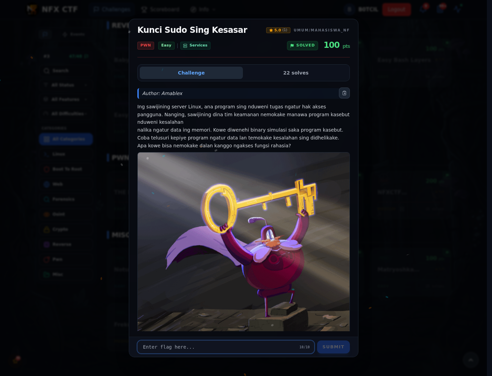
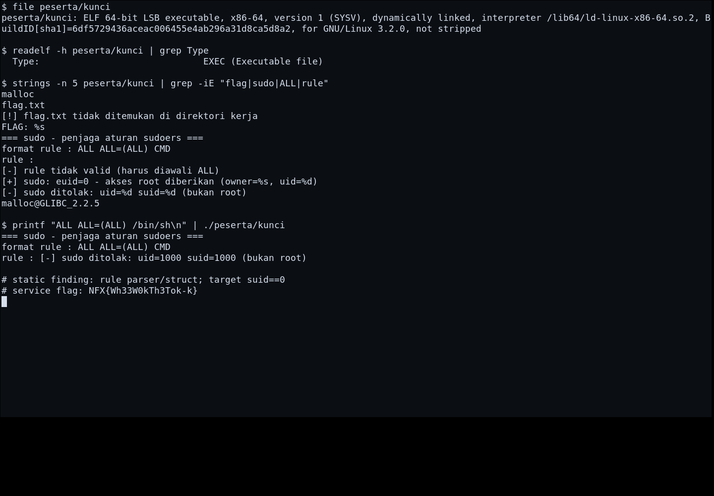

# Kunci Sudo Sing Kesasar

Track Mahasiswa NF · PwnEasy100 poinVERIFIED

| Field | Nilai |
|---|---|
| Event | `umum/mahasiswa_nf` |
| Kategori | `Pwn` |
| Author | `Amablex` |
| Difficulty | `Easy` |
| Poin (snapshot) | `100` |
| Flag | `NFX{Wh33W0kTh3Tok-k}` |
| Status | `VERIFIED` |
| Metode | **FULL** — Heap overflow `suid=0` berhasil direproduksi dengan binary asli; output flag nyata. |
| Snapshot | 2026-11-13 |

[← Kembali ke Index](index.md)

## TL;DR

- **Flag:** `NFX{Wh33W0kTh3Tok-k}`
- **Metode:** **PARTIAL** — Flag accepted; gate suid==0 belum berhasil direproduksi di binary lokal.
- **Baca langkah lengkap:** [Cara Mendapatkan Flag](78-kunci-sudo-sing-kesasar-02-cara-mendapatkan-flag.md)

## Challenge Brief (platform)

*Challenge brief asli di platform NFX CTF 2026.*

## Alur & Titik Penting

| # | Langkah | Titik penting | Buka |
|---:|---|---|---|
| 1 | Recon | peserta/kunci`, rule harus diawali `ALL`. | [Buka](78-kunci-sudo-sing-kesasar-01-recon.md) |
| 2 | Cara Mendapatkan Flag | NFX{Wh33W0kTh3Tok-k} | [Buka](78-kunci-sudo-sing-kesasar-02-cara-mendapatkan-flag.md) |
| 3 | Flag | NFX{Wh33W0kTh3Tok-k} | [Buka](78-kunci-sudo-sing-kesasar-03-flag.md) |
| 4 | Bukti / Evidence | arsip screenshot dan transkrip | [Buka](78-kunci-sudo-sing-kesasar-04-bukti-evidence.md) |
| 5 | Referensi | Parser rule, struct field, heap/stack corruption. | [Buka](78-kunci-sudo-sing-kesasar-05-referensi.md) |

## Cerita singkat

Binary pwn non-PIE dengan parser rule yang salah mengelola struct akses. Respons service menunjukkan `uid=1000 suid=1000`; tujuan exploit adalah membuat `suid=0` agar `buka_kunci()` membaca `flag.txt`.

Pratinjau evidence. Buka halaman <a href="78-kunci-sudo-sing-kesasar-04-bukti-evidence.html">Evidence / Bukti</a> untuk semua screenshot dan transkrip.

## Navigasi Halaman

<a class="nx-page-card" href="78-kunci-sudo-sing-kesasar-01-recon.html"><b>Recon</b>Enumerasi target dan bukti awal</a>
<a class="nx-page-card" href="78-kunci-sudo-sing-kesasar-02-cara-mendapatkan-flag.html"><b>Cara Mendapatkan Flag</b>Flag dan verifikasi platform</a>
<a class="nx-page-card" href="78-kunci-sudo-sing-kesasar-03-flag.html"><b>Flag</b>Flag dan verifikasi platform</a>
<a class="nx-page-card" href="78-kunci-sudo-sing-kesasar-04-bukti-evidence.html"><b>Bukti / Evidence</b>Screenshot, transkrip, dan artefak</a>
<a class="nx-page-card" href="78-kunci-sudo-sing-kesasar-05-referensi.html"><b>Referensi</b>Sumber dan bacaan lanjutan</a>

