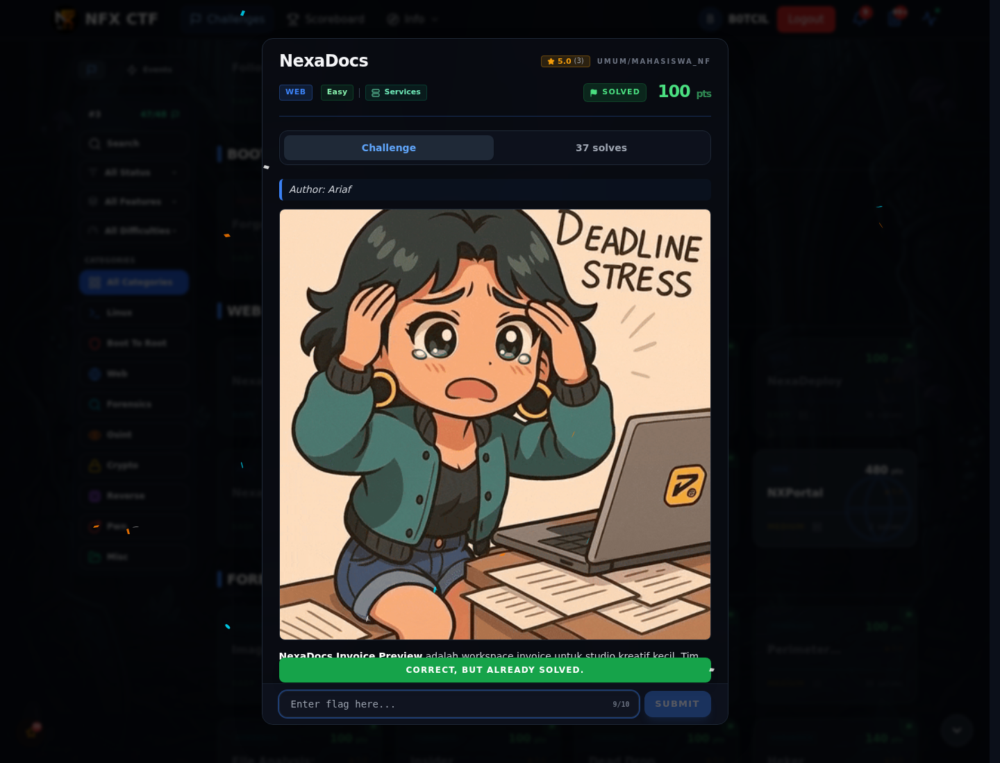

# NexaDocs — Flag & Verifikasi

[← Overview](79-nexadocs.md) · [Index](index.md)

> **Langkah 2/5 — Cara Mendapatkan Flag.** Cara Mendapatkan Flag
>
> **Titik penting:** NFX{j1nja2_sstI_rce_v1a_gl0bals}
>
> **Berikutnya:** [Flag](79-nexadocs-03-flag.md)

> **Flag:** `NFX{j1nja2_sstI_rce_v1a_gl0bals}`
> **Status:** `VERIFIED`

1. Cari fitur preview header/footer yang menerima template.
2. Uji `{{7*7}}`; kalau jadi 49, lanjut ke RCE.
3. Baca flag dari server.

### Bukti submit di platform

*Submit flag di platform: `CORRECT, BUT ALREADY SOLVED.`*

> **Bukti submit:** screenshot form challenge di atas menampilkan `CORRECT, BUT ALREADY SOLVED.`
