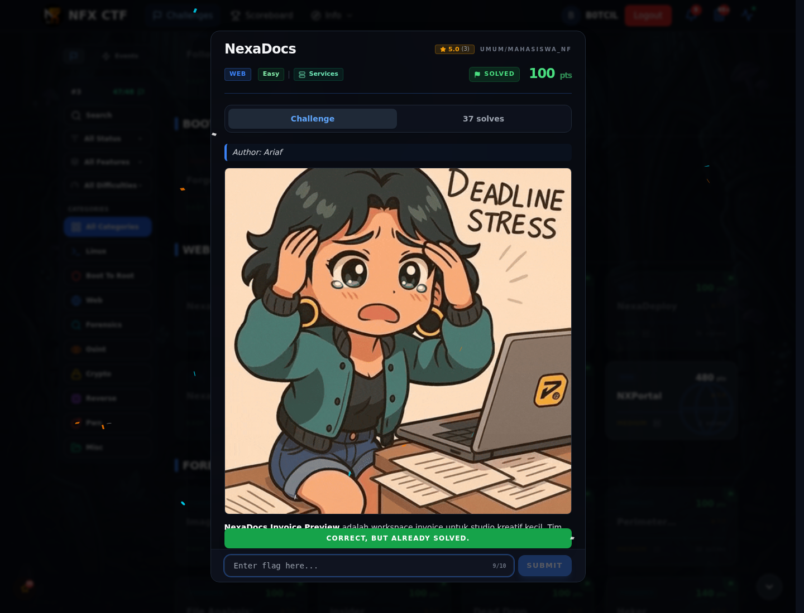

# NexaDocs — Flag & Verifikasi

[← Overview](79-nexadocs.md) · [Index](index.md)

> **Langkah 3/5 — Flag.** Flag
>
> **Titik penting:** NFX{j1nja2_sstI_rce_v1a_gl0bals}
>
> **Berikutnya:** [Bukti / Evidence](79-nexadocs-04-bukti-evidence.md)

> **Flag:** `NFX{j1nja2_sstI_rce_v1a_gl0bals}`
> **Status:** `VERIFIED`

```text
NFX{j1nja2_sstI_rce_v1a_gl0bals}
```

### Bukti submit di platform



*Submit flag di platform: `CORRECT, BUT ALREADY SOLVED.`*

> **Bukti submit:** screenshot form challenge di atas menampilkan `CORRECT, BUT ALREADY SOLVED.`
