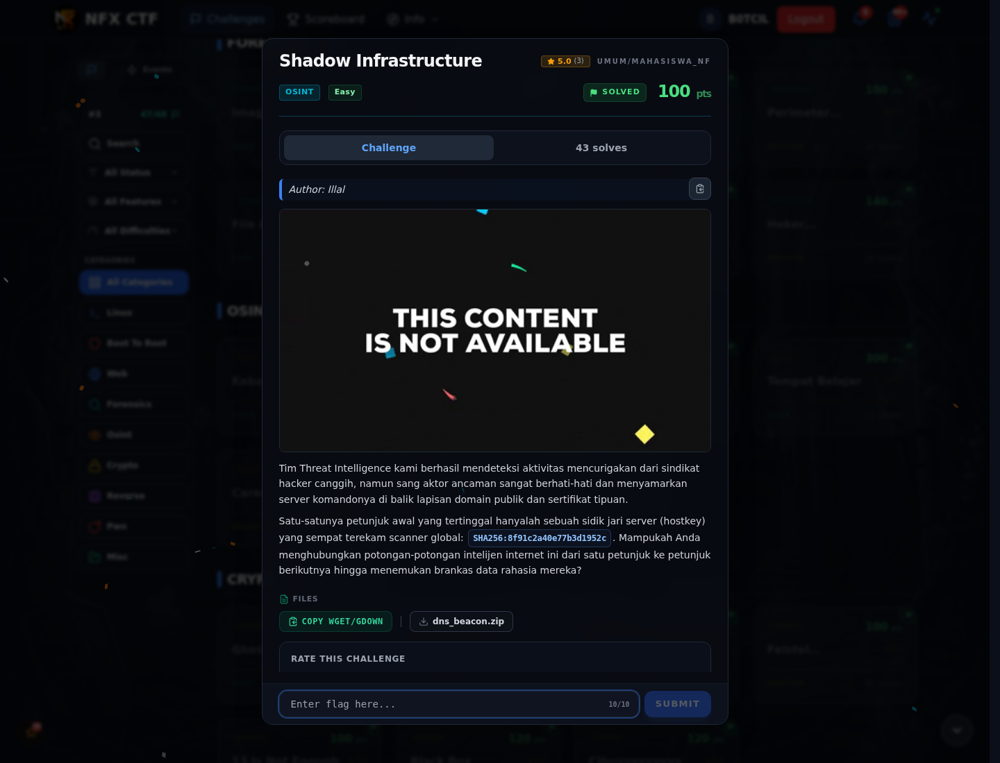

# Shadow Infrastructure — Jejak Awal

[← Overview](80-shadow-infrastructure.md) · [Index](index.md)

> **Langkah 1/5 — Jejak Awal.**
>
> **Titik penting:** hostkey `SHA256:8f91c2a40e77b3d1952c` + `dns_beacon.zip`.

Brief challenge hanya memberi satu petunjuk:

```text
SHA256:8f91c2a40e77b3d1952c
```

Attachment `dns_beacon.zip` berisi empat artefak intelijen:

| File | Isi |
|---|---|
| `shodan_scan.json` | snapshot scanner global: IP, ASN, port, SSH fingerprint |
| `passive_dns.csv` | riwayat A record domain |
| `ct_certificates.json` | sertifikat publik + SAN |
| `dns_txt_records.txt` | TXT record `beacon-vault` dan decoy `health-check` |

Tujuan: hubungkan **hostkey → IP → domain → sertifikat → DNS TXT → flag**.

### Evidence langkah ini



*Challenge brief asli di platform NFX CTF 2026.*
