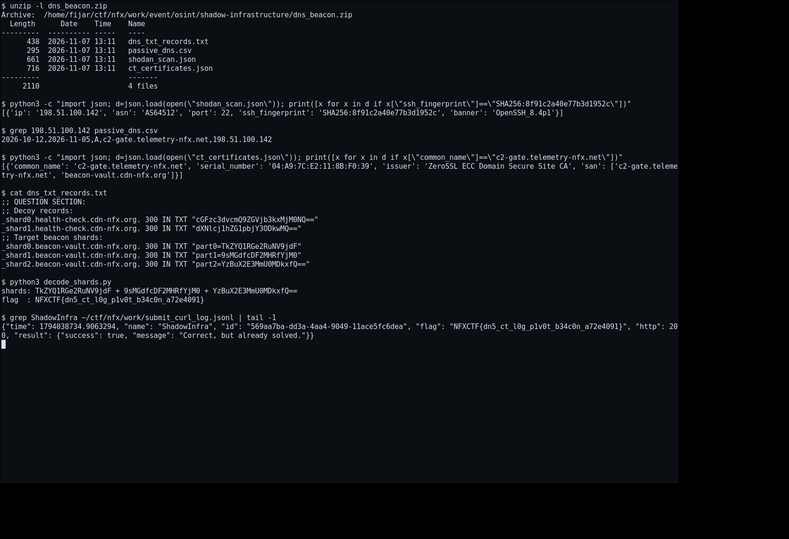

# Shadow Infrastructure — Cara Mendapatkan Flag

[← Overview](80-shadow-infrastructure.md) · [Index](index.md)

> **Langkah 2/5 — Cara Mendapatkan Flag.**
>
> **Flag:** `NFXCTF{dn5_ct_l0g_p1v0t_b34c0n_a72e4091}`
> **Status:** `VERIFIED`

## 1. Bongkar attachment

```bash
unzip -o dns_beacon.zip -d dns_beacon
find dns_beacon -type f -printf '%f\n'
# ct_certificates.json
# dns_txt_records.txt
# passive_dns.csv
# shodan_scan.json
```

## 2. Cocokkan hostkey di scanner publik

`shodan_scan.json` adalah snapshot scanner global. Cari fingerprint yang diberikan
challenge:

```bash
jq '.[] | select(.ssh_fingerprint=="SHA256:8f91c2a40e77b3d1952c")' \
  dns_beacon/shodan_scan.json
```

Hasil:

```json
{
  "ip": "198.51.100.142",
  "asn": "AS64512",
  "port": 22,
  "ssh_fingerprint": "SHA256:8f91c2a40e77b3d1952c",
  "banner": "OpenSSH_8.4p1"
}
```

`passive_dns.csv` mengaitkan IP itu ke `c2-gate.telemetry-nfx.net`.

## 3. Pivot ke Certificate Transparency

Cari sertifikat yang mencakup domain tersebut:

```bash
jq '.[] | select(.common_name=="c2-gate.telemetry-nfx.net")' \
  dns_beacon/ct_certificates.json
```

Hasil penting: SAN-nya juga memuat `beacon-vault.cdn-nfx.org`.

```json
{
  "common_name": "c2-gate.telemetry-nfx.net",
  "san": ["c2-gate.telemetry-nfx.net", "beacon-vault.cdn-nfx.org"]
}
```

Di dunia nyata langkah ini setara dengan query `crt.sh` / CT log untuk
`telemetry-nfx.net` lalu melihat SAN yang tidak biasa.

## 4. Baca DNS TXT shard

```bash
cat dns_beacon/dns_txt_records.txt
```

Record target:

```text
_shard0.beacon-vault.cdn-nfx.org. 300 IN TXT "part0=TkZYQ1RGe2RuNV9jdF"
_shard1.beacon-vault.cdn-nfx.org. 300 IN TXT "part1=9sMGdfcDF2MHRfYjM0"
_shard2.beacon-vault.cdn-nfx.org. 300 IN TXT "part2=YzBuX2E3MmU0MDkxfQ=="
```

Record `health-check.cdn-nfx.org` adalah decoy:

```text
_shard0.health-check.cdn-nfx.org. 300 IN TXT "cGFzc3dvcmQ9ZGVjb3kxMjM0NQ=="
_shard1.health-check.cdn-nfx.org. 300 IN TXT "dXNlcj1hZG1pbjY3ODkwMQ=="
```

## 5. Gabung dan decode

```bash
P0='TkZYQ1RGe2RuNV9jdF'
P1='9sMGdfcDF2MHRfYjM0'
P2='YzBuX2E3MmU0MDkxfQ=='
printf '%s%s%s' "$P0" "$P1" "$P2" | base64 -d
```

Output:

```text
NFXCTF{dn5_ct_l0g_p1v0t_b34c0n_a72e4091}
```

Flag memakai prefix **NFXCTF**, bukan `NFX`. Ini sebabnya tebakan `NFX{...}`
gagal.

## 6. Verifikasi

Log submit asli (`work/submit_curl_log.jsonl`):

```json
{"name":"ShadowInfra","id":"569aa7ba-dd3a-4aa4-9049-11ace5fc6dea","flag":"NFXCTF{dn5_ct_l0g_p1v0t_b34c0n_a72e4091}","http":200,"result":{"success":true,"message":"Correct, but already solved."}}
```

### Evidence langkah ini



*Terminal evidence (arsip/log asli) — `00b-terminal-evidence.png`.*
