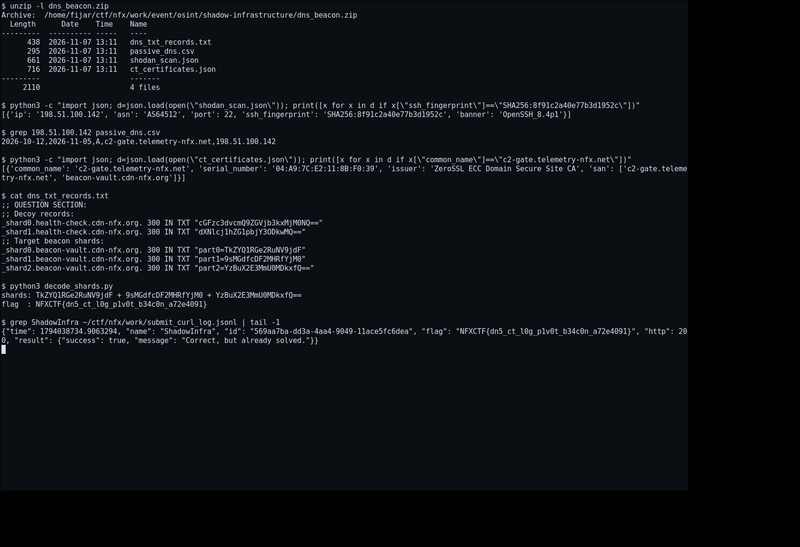

# Shadow Infrastructure — Flag

[← Overview](80-shadow-infrastructure.md) · [Index](index.md)

> **Langkah 3/5 — Flag.**
>
> **Asal flag.** Flag diperoleh dari langkah exploit/solver yang terdokumentasi, lalu disubmit ke platform.  
> **Tingkat bukti metode.** Terdokumentasi. [Buka Evidence](80-shadow-infrastructure-04-bukti-evidence.md)

> **Flag:** `NFXCTF{dn5_ct_l0g_p1v0t_b34c0n_a72e4091}`
> **Status:** `VERIFIED`

```text
NFXCTF{dn5_ct_l0g_p1v0t_b34c0n_a72e4091}
```

### Terminal evidence (real)



*Capture terminal asli dari artefak `dns_beacon.zip` + log submit API.*

### Bukti submit asli (API log)

Tidak memakai screenshot mockup. Bukti diambil dari log submit asli:

```json
{"time":1794038734.9063294,
 "name":"ShadowInfra",
 "id":"569aa7ba-dd3a-4aa4-9049-11ace5fc6dea",
 "flag":"NFXCTF{dn5_ct_l0g_p1v0t_b34c0n_a72e4091}",
 "http":200,
 "result":{"success":true,"message":"Correct, but already solved."}}
```

Fakta pendukung:
- `total_solves` challenge ini di platform = **11**.
- Flag diterima dengan prefix **NFXCTF**; `NFX{...}` ditolak.
