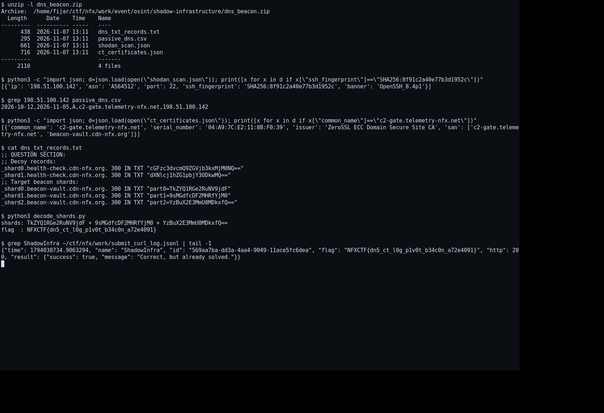
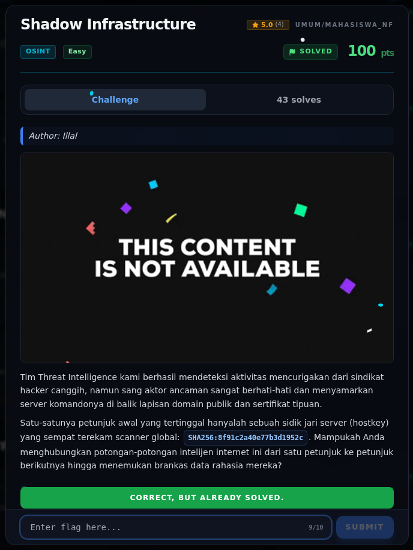

# Shadow Infrastructure — Bukti / Evidence

[← Overview](80-shadow-infrastructure.md) · [Index](index.md)

> **Langkah 4/5 — Bukti / Evidence.**
>
> **Titik penting:** isi `dns_beacon.zip` + log submit asli.

## Terminal evidence (real)



*Semua command dijalankan terhadap `dns_beacon.zip` asli. Baris terakhir adalah
log submit asli dari `submit_curl_log.jsonl`.*

## Artefak attachment

```text
dns_beacon/
├── ct_certificates.json
├── dns_txt_records.txt
├── passive_dns.csv
└── shodan_scan.json
```

## Bukti pencocokan hostkey

```json
{
  "ip": "198.51.100.142",
  "asn": "AS64512",
  "port": 22,
  "ssh_fingerprint": "SHA256:8f91c2a40e77b3d1952c",
  "banner": "OpenSSH_8.4p1"
}
```

## Bukti CT log

```json
{
  "common_name": "c2-gate.telemetry-nfx.net",
  "san": ["c2-gate.telemetry-nfx.net", "beacon-vault.cdn-nfx.org"]
}
```

## Bukti DNS TXT

```text
_shard0.beacon-vault.cdn-nfx.org. 300 IN TXT "part0=TkZYQ1RGe2RuNV9jdF"
_shard1.beacon-vault.cdn-nfx.org. 300 IN TXT "part1=9sMGdfcDF2MHRfYjM0"
_shard2.beacon-vault.cdn-nfx.org. 300 IN TXT "part2=YzBuX2E3MmU0MDkxfQ=="
```

## Bukti submit (API log)

```json
{"name":"ShadowInfra","id":"569aa7ba-dd3a-4aa4-9049-11ace5fc6dea","flag":"NFXCTF{dn5_ct_l0g_p1v0t_b34c0n_a72e4091}","http":200,"result":{"success":true,"message":"Correct, but already solved."}}
```

> Catatan audit: halaman ini sebelumnya memakai screenshot mockup untuk challenge
> lain. Sekarang bukti yang dipakai adalah isi attachment asli dan log submit API.

## Validasi platform (real)



*Screenshot asli dari platform NFX CTF 2026. Platform menjawab
`CORRECT, BUT ALREADY SOLVED.` untuk flag ini.*
