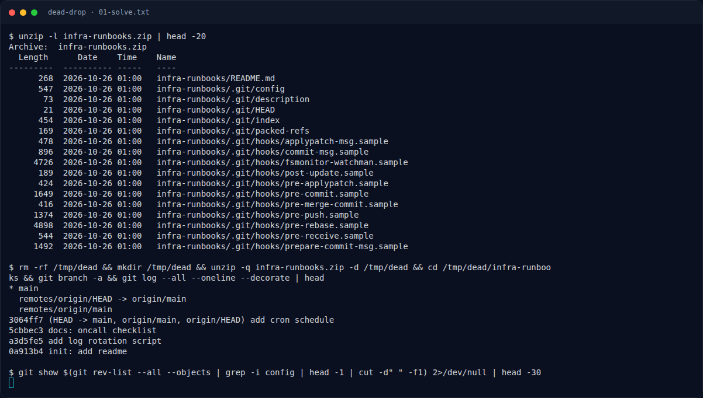

# Dead Drop — Jejak awal

[← Overview](81-dead-drop.md) · [Index](index.md)

> **Langkah 1/5.** Rahasia ada di `.git/config`, bukan di history `main`.
>
> **Berikutnya:** [Cara Mendapatkan Flag](81-dead-drop-02-cara-mendapatkan-flag.md)

```bash
unzip infra-runbooks.zip
cd infra-runbooks
git log --oneline --all
git branch -a
```

History `main` hanya README, rotasi log, dan cron. `git branch -a` lokal juga hanya `main`.

Yang mencurigakan:

```text
[http "https://github.com/"]
    extraheader = AUTHORIZATION: basic <base64>
```

### Evidence langkah ini



*Terminal evidence — transkrip langkah — `term-01-solve.png`.*

**Berkas mentah terkait:**

- [`01-solve.txt`](assets/dead-drop/01-solve.txt)
