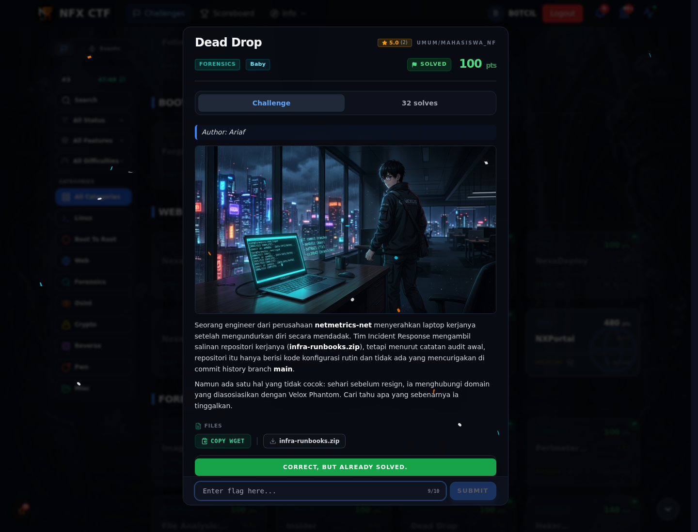

# Dead Drop — Flag & Verifikasi

[← Overview](81-dead-drop.md) · [Index](index.md)

> **Langkah 3/5 — Flag.** Flag
>
> **Titik penting:** NFX{g1t_c0nf1g_h34d3r_l34k_h1dd3n_br4nch_9c1e7a}
>
> **Berikutnya:** [Bukti / Evidence](81-dead-drop-04-bukti-evidence.md)

> **Flag:** `NFX{g1t_c0nf1g_h34d3r_l34k_h1dd3n_br4nch_9c1e7a}`
> **Status:** `VERIFIED`

```text
NFX{g1t_c0nf1g_h34d3r_l34k_h1dd3n_br4nch_9c1e7a}
```

### Bukti submit di platform



*Submit flag di platform: `CORRECT, BUT ALREADY SOLVED.`*

> **Bukti submit:** screenshot form challenge di atas menampilkan `CORRECT, BUT ALREADY SOLVED.`
