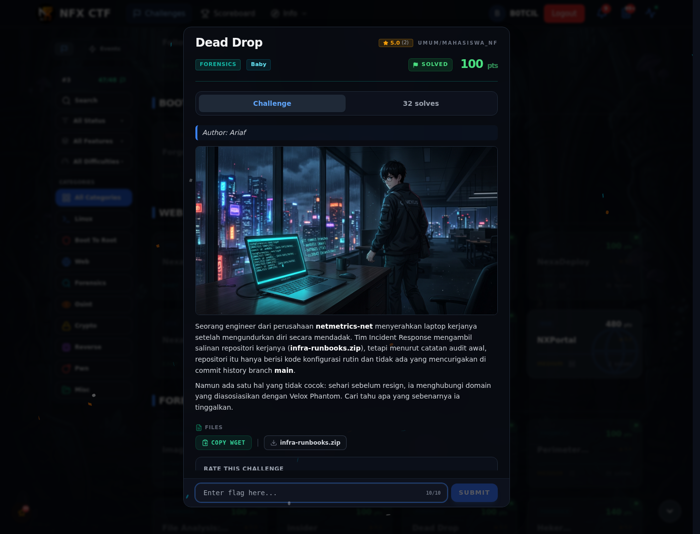
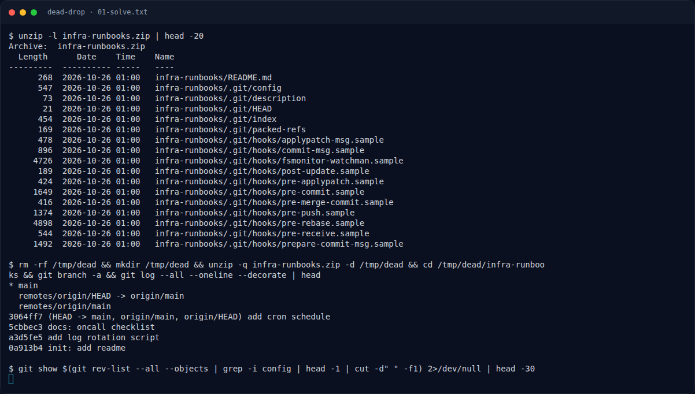
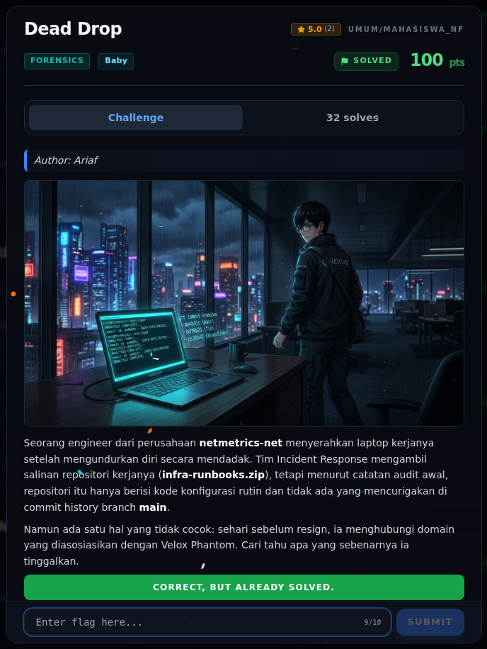
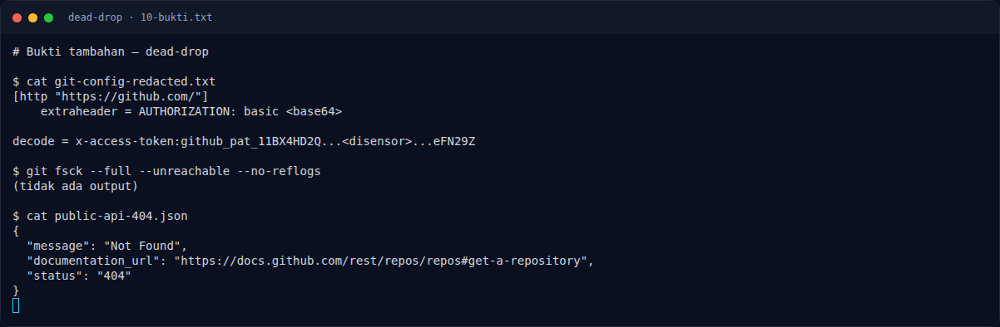

# Dead Drop — Evidence / Bukti

3 screenshot1 transkrip / script

[← Overview](81-dead-drop.md) · [Index](index.md)

> **Langkah 4/5 — Bukti / Evidence.** Bukti / Evidence
>
> **Titik penting:** arsip screenshot dan transkrip
>
> **Berikutnya:** [Referensi](81-dead-drop-05-referensi.md)

## Arsip Evidence

> Semua file berasal dari `assets/dead-drop/`. Screenshot platform dan terminal adalah bukti asli dari sesi solve; transkrip mentah tetap ditautkan di bagian bawah.

### Platform

<figure><figcaption>00-challenge-platform.png</figcaption></figure>

*Challenge brief asli di platform NFX CTF 2026.*

<figure><figcaption>Terminal evidence (real)</figcaption></figure>

*Terminal evidence (real).*

### Terminal (arsip sesi)

<figure><figcaption>term-01-solve.png</figcaption></figure>

*Terminal evidence — `01-solve.txt` (arsip transkrip sesi solve).*

### Transkrip mentah & script

- [`01-solve.txt`](assets/dead-drop/01-solve.txt)

## Validasi platform (real)

*Screenshot asli dari platform NFX CTF 2026. Platform menjawab
`CORRECT, BUT ALREADY SOLVED.` untuk flag ini.*

## Tabel Evidence

- Challenge brief: `assets/dead-drop/00-challenge-platform.png`
- Terminal evidence (real): `assets/dead-drop/00b-terminal-evidence.png`
- Catatan mentah: lihat folder `assets/dead-drop/`

## Bukti tambahan (Dead Drop)

*Terminal evidence — config leak, `git fsck`, dan public API 404.*

- `.git/config` menyimpan `http.extraheader` berisi token GitHub (disensor).
- `git branch -a` hanya `main`; `git fsck --full --unreachable --no-reflogs`
  kosong; semua blob dipindai, tidak ada flag.
- `https://api.github.com/repos/netmetrics-net/infra-runbooks` → 404.
- Repo publik organisasi hanya `c2-deploy-pipeline`.
- Branch remote tidak ada di zip; klaim branch tersembunyi tidak bisa
  diverifikasi dari artefak ini.

**Berkas mentah:** [ANALYSIS.md](assets/dead-drop/10-ANALYSIS.md) ·
[git-config-redacted.txt](assets/dead-drop/10-git-config-redacted.txt) ·
[public-api-404.json](assets/dead-drop/10-public-api-404.json) ·
[org-repos.json](assets/dead-drop/10-org-repos.json)
