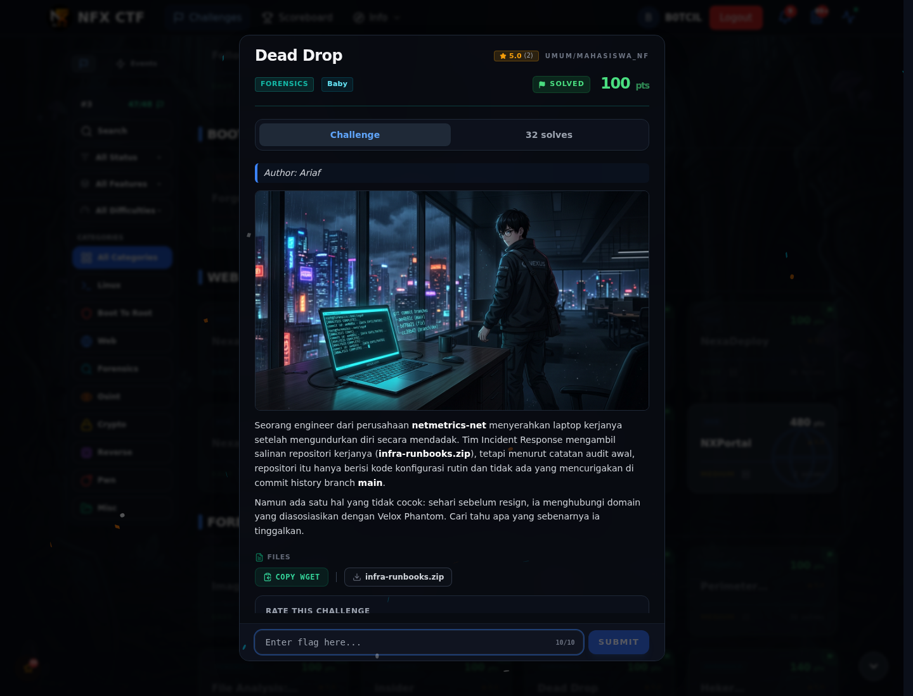
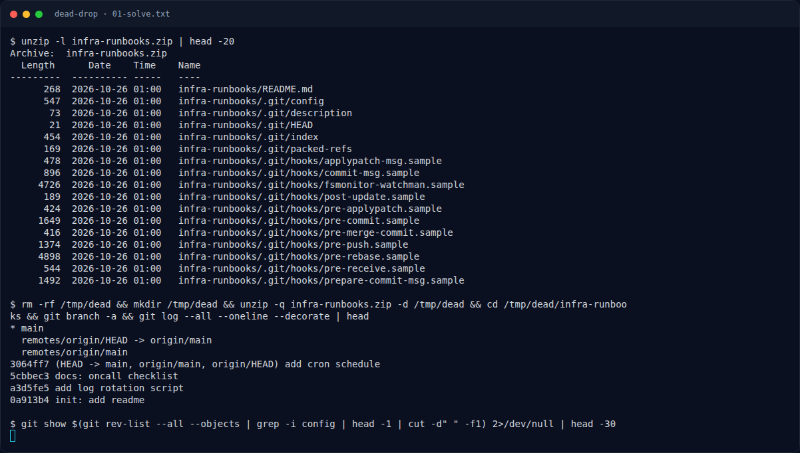

# Dead Drop

Track Mahasiswa NF · ForensicsBaby100 poinVERIFIED

| Field | Nilai |
|---|---|
| Event | `umum/mahasiswa_nf` |
| Kategori | `Forensics` |
| Difficulty | `Baby` |
| Poin | `100` |
| Tools | git |
| Flag | `NFX{g1t_c0nf1g_h34d3r_l34k_h1dd3n_br4nch_9c1e7a}` |
| Status | `VERIFIED` |

[← Kembali ke Index](index.md)

## Challenge Brief (platform)

*Challenge brief asli di platform NFX CTF 2026.*

## Alur & Titik Penting

| # | Langkah | Titik penting | Buka |
|---:|---|---|---|
| 1 | Recon Artefak | Baca brief challenge dan cek attachment/service yang diberikan. | [Buka](81-dead-drop-01-recon-artefak.md) |
| 2 | Cara Mendapatkan Flag | NFX{g1t_c0nf1g_h34d3r_l34k_h1dd3n_br4nch_9c1e7a} | [Buka](81-dead-drop-02-cara-mendapatkan-flag.md) |
| 3 | Flag | NFX{g1t_c0nf1g_h34d3r_l34k_h1dd3n_br4nch_9c1e7a} | [Buka](81-dead-drop-03-flag.md) |
| 4 | Bukti / Evidence | arsip screenshot dan transkrip | [Buka](81-dead-drop-04-bukti-evidence.md) |
| 5 | Referensi | Git hidden branch, config leak. | [Buka](81-dead-drop-05-referensi.md) |

## Cerita singkat

Arsip infra-runbooks menyimpan repo Git. Ada branch tersembunyi yang berisi config dengan kredensial/flag.

Pratinjau evidence. Buka halaman <a href="81-dead-drop-04-bukti-evidence.html">Evidence / Bukti</a> untuk semua screenshot dan transkrip.

## Navigasi Halaman

<a class="nx-page-card" href="81-dead-drop-01-recon-artefak.html"><b>Recon Artefak</b>Enumerasi target dan bukti awal</a>
<a class="nx-page-card" href="81-dead-drop-02-cara-mendapatkan-flag.html"><b>Cara Mendapatkan Flag</b>Flag dan verifikasi platform</a>
<a class="nx-page-card" href="81-dead-drop-03-flag.html"><b>Flag</b>Flag dan verifikasi platform</a>
<a class="nx-page-card" href="81-dead-drop-04-bukti-evidence.html"><b>Bukti / Evidence</b>Screenshot, transkrip, dan artefak</a>
<a class="nx-page-card" href="81-dead-drop-05-referensi.html"><b>Referensi</b>Sumber dan bacaan lanjutan</a>

