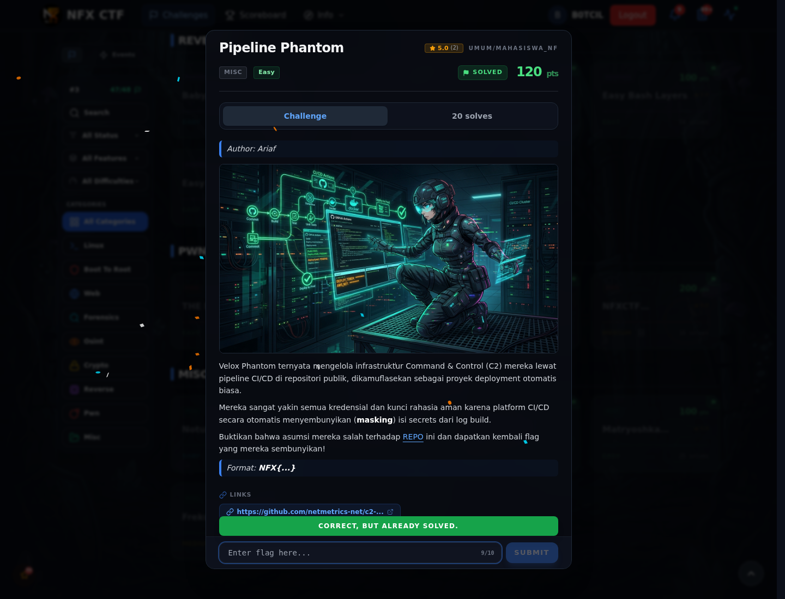

# Pipeline Phantom — Flag & Verifikasi

[← Overview](82-pipeline-phantom.md) · [Index](index.md)

> **Langkah 2/5 — Cara Mendapatkan Flag.** Cara Mendapatkan Flag
>
> **Titik penting:** NFX{gh_4ct10ns_m4sk_byp4ss_4nd_0rph4n_c0mm1t_l34k_9f82}
>
> **Berikutnya:** [Flag](82-pipeline-phantom-03-flag.md)

> **Flag:** `NFX{gh_4ct10ns_m4sk_byp4ss_4nd_0rph4n_c0mm1t_l34k_9f82}`
> **Status:** `VERIFIED`

1. Unduh log Actions.
2. Cari baris `DEBUG_PAYLOAD`.
3. Cocokkan dengan orphan commit untuk melengkapi flag.

### Bukti submit di platform

*Submit flag di platform: `CORRECT, BUT ALREADY SOLVED.`*

> **Bukti submit:** screenshot form challenge di atas menampilkan `CORRECT, BUT ALREADY SOLVED.`
