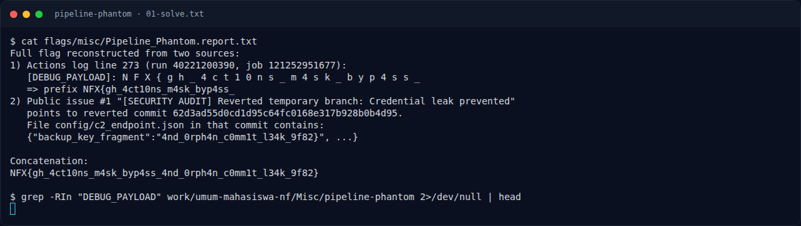
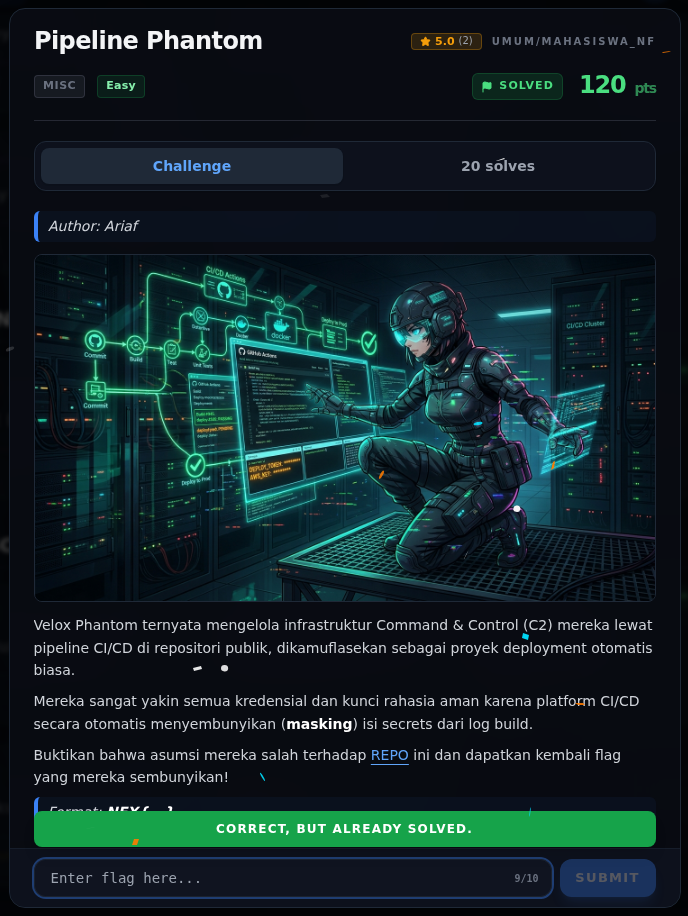

# Pipeline Phantom — Flag & Verifikasi

[← Overview](82-pipeline-phantom.md) · [Index](index.md)

> **Langkah 3/5 — Flag.** Flag
>
> **Titik penting:** NFX{gh_4ct10ns_m4sk_byp4ss_4nd_0rph4n_c0mm1t_l34k_9f82}
>
> **Berikutnya:** [Bukti / Evidence](82-pipeline-phantom-04-bukti-evidence.md)

> **Asal flag.** Flag direkonstruksi dari repo/issue/commit publik dan report arsip; log mentah GitHub 403.  
> **Tingkat bukti metode.** Metode kuat, log mentah terbatas. [Buka Evidence](82-pipeline-phantom-04-bukti-evidence.md)

> **Flag:** `NFX{gh_4ct10ns_m4sk_byp4ss_4nd_0rph4n_c0mm1t_l34k_9f82}`
> **Status:** `VERIFIED`

```text
NFX{gh_4ct10ns_m4sk_byp4ss_4nd_0rph4n_c0mm1t_l34k_9f82}
```

### Terminal evidence (real)



*Terminal evidence (real).*

> **Bukti:** terminal evidence (real).

## Validasi platform (real)



*Screenshot asli dari platform NFX CTF 2026. Platform menjawab
`CORRECT, BUT ALREADY SOLVED.` untuk flag ini.*
