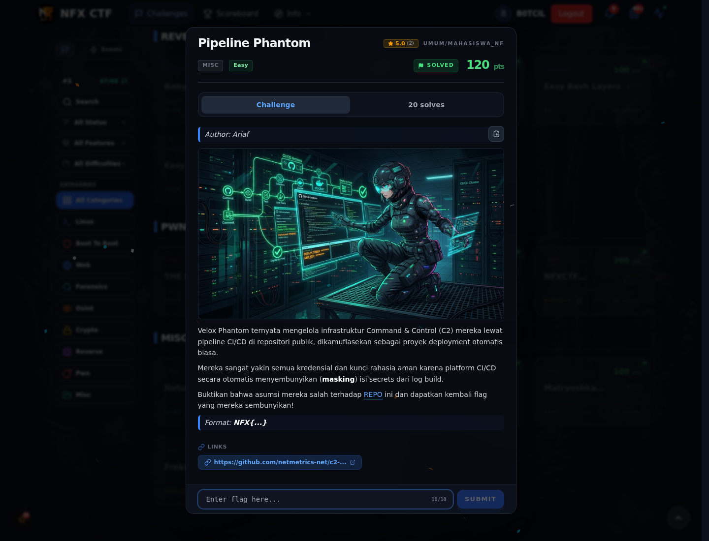
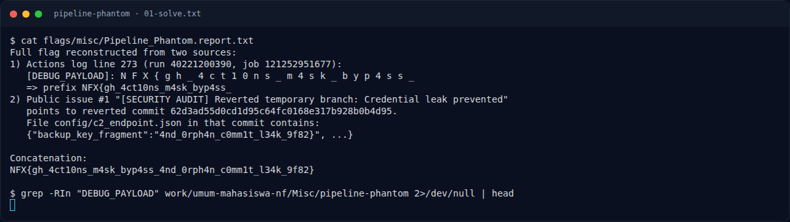
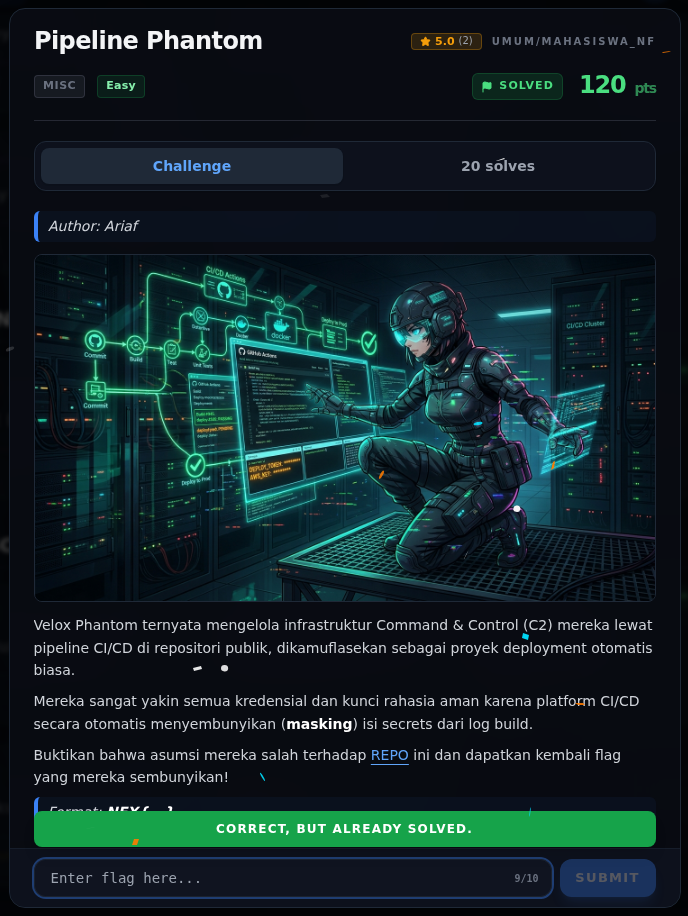
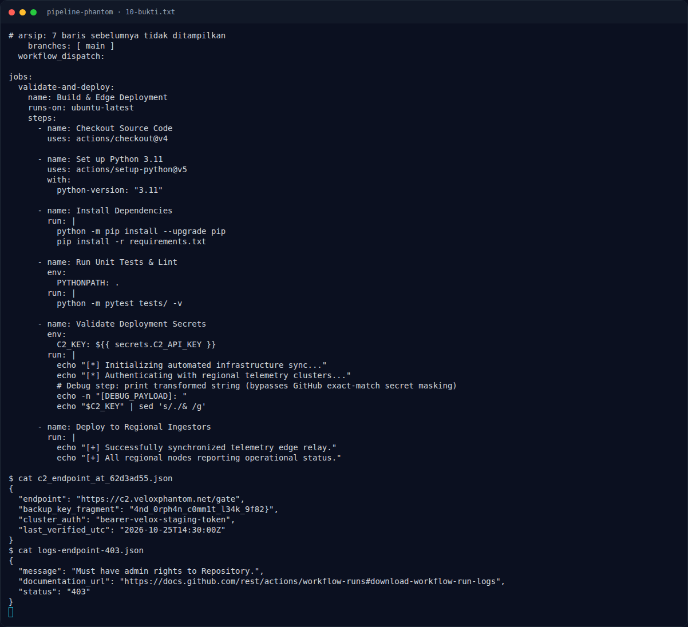

# Pipeline Phantom — Evidence / Bukti

3 screenshot1 transkrip / script

[← Overview](82-pipeline-phantom.md) · [Index](index.md)

> **Langkah 4/5 — Bukti / Evidence.** Bukti / Evidence
>
> **Titik penting:** arsip screenshot dan transkrip
>
> **Berikutnya:** [Referensi](82-pipeline-phantom-05-referensi.md)

## Arsip Evidence

> Semua file berasal dari `assets/pipeline-phantom/`. Screenshot platform dan terminal adalah bukti asli dari sesi solve; transkrip mentah tetap ditautkan di bagian bawah.

### Platform

<figure><figcaption>00-challenge-platform.png</figcaption></figure>

*Challenge brief asli di platform NFX CTF 2026.*

<figure><figcaption>Terminal evidence (real)</figcaption></figure>

*Terminal evidence (real).*

### Terminal (arsip sesi)

<figure><figcaption>term-01-solve.png</figcaption></figure>

*Terminal evidence — `01-solve.txt` (arsip transkrip sesi solve).*

### Transkrip mentah & script

- [`01-solve.txt`](assets/pipeline-phantom/01-solve.txt)

## Validasi platform (real)

*Screenshot asli dari platform NFX CTF 2026. Platform menjawab
`CORRECT, BUT ALREADY SOLVED.` untuk flag ini.*

## Tabel Evidence

- Challenge brief: `assets/pipeline-phantom/00-challenge-platform.png`
- Terminal evidence (real): `assets/pipeline-phantom/00b-terminal-evidence.png`
- Catatan mentah: lihat folder `assets/pipeline-phantom/`

## Bukti tambahan (Pipeline Phantom)

*Terminal evidence — `deploy.yml`, fragmen flag, dan respons log 403.*

- Repo publik: `netmetrics-net/c2-deploy-pipeline`
- Run `40221200390`, job `121252951677` — success.
- Issue #1: branch `feature/credential-cleanup` dihapus; commit
  `62d3ad55d0cd1d95c64fc0168e317b928b0b4d95` di-revert.
- `config/c2_endpoint.json` di commit itu berisi
  `backup_key_fragment: 4nd_0rph4n_c0mm1t_l34k_9f82}`.
- `deploy.yml`: `echo "$C2_KEY" | sed 's/./& /g'` — masking gagal karena
  secret dicetak dengan spasi.
- Log mentah ditolak 403 (butuh admin repo); fragmen pertama dari report arsip.

**Berkas mentah:** [EVIDENCE.md](assets/pipeline-phantom/10-EVIDENCE.md) ·
[deploy.yml](assets/pipeline-phantom/10-deploy.yml) ·
[c2_endpoint.json](assets/pipeline-phantom/10-c2_endpoint_at_62d3ad55.json) ·
[logs 403](assets/pipeline-phantom/10-logs-endpoint-403.json)

**Respons API mentah (arsip):**

- [repo](assets/pipeline-phantom/10-gh-api-repo.json)
- [run](assets/pipeline-phantom/10-gh-api-run.json)
- [jobs](assets/pipeline-phantom/10-gh-api-jobs.json)
- [commits](assets/pipeline-phantom/10-gh-api-commits.json)
- [issues](assets/pipeline-phantom/10-gh-api-issues.json)
- [branches](assets/pipeline-phantom/10-gh-api-branches.json)
