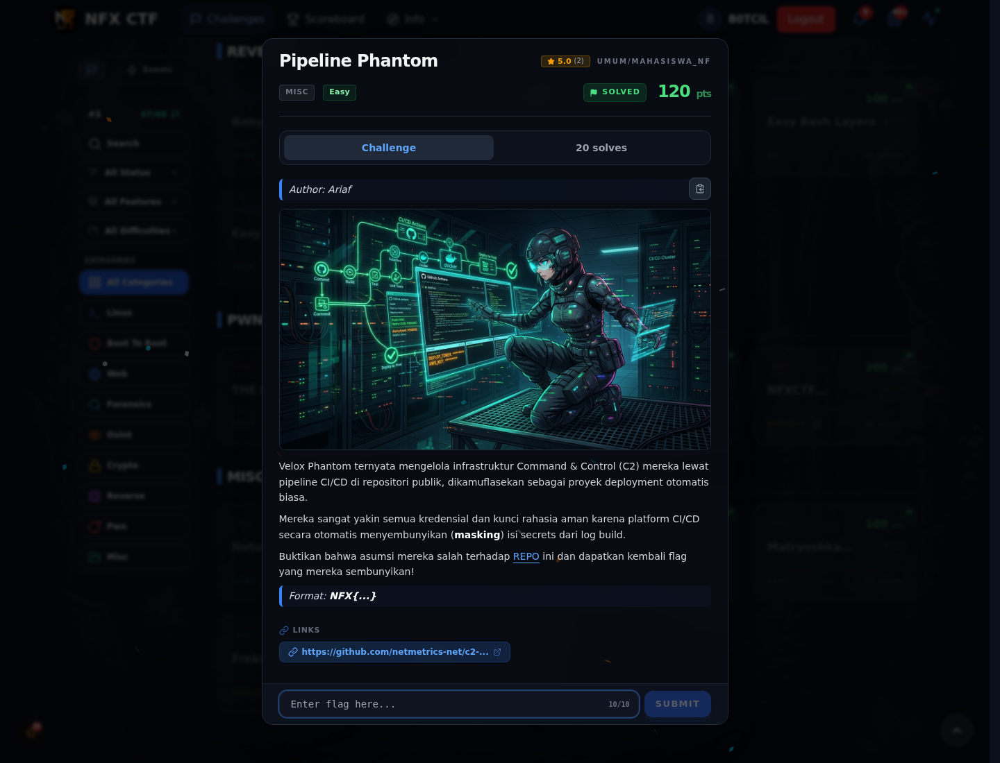

# Pipeline Phantom — Referensi

[← Overview](82-pipeline-phantom.md) · [Index](index.md)

> **Langkah 5/5 — Referensi.** GitHub Actions log, orphan commit.
>
> **Titik penting:** GitHub Actions log, orphan commit.
>
> **Selesai.** Kembali ke [Overview](82-pipeline-phantom.md).

GitHub Actions log, orphan commit.

### Evidence langkah ini

*Challenge brief asli di platform NFX CTF 2026.*
