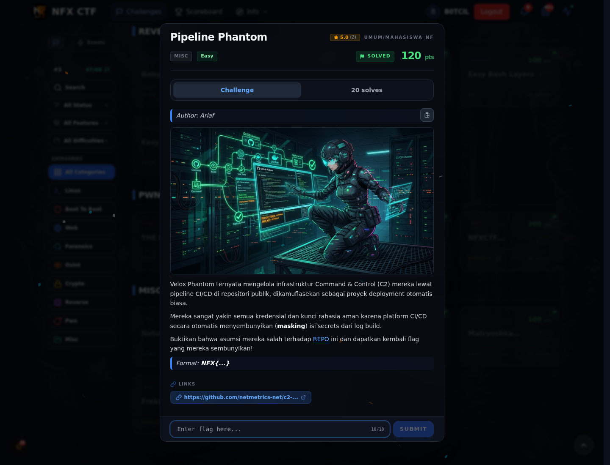
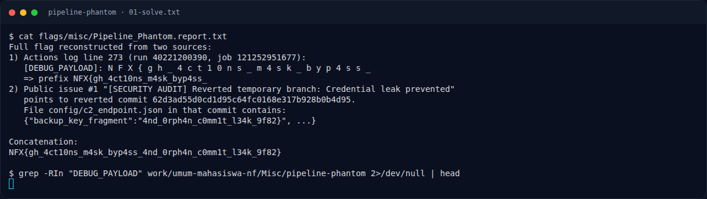

# Pipeline Phantom

Track Mahasiswa NF · MiscEasy120 poinVERIFIED

| Field | Nilai |
|---|---|
| Event | `umum/mahasiswa_nf` |
| Kategori | `Misc` |
| Author | `Ariaf` |
| Difficulty | `Easy` |
| Poin | `120` |
| Tools | git |
| Flag | `NFX{gh_4ct10ns_m4sk_byp4ss_4nd_0rph4n_c0mm1t_l34k_9f82}` |
| Status | `VERIFIED` |
[← Kembali ke Index](index.md)

## TL;DR

- **Flag:** `NFX{gh_4ct10ns_m4sk_byp4ss_4nd_0rph4n_c0mm1t_l34k_9f82}`
- **Baca langkah lengkap:** [Cara Mendapatkan Flag](82-pipeline-phantom-02-cara-mendapatkan-flag.md)

## Challenge Brief (platform)

*Challenge brief asli di platform NFX CTF 2026.*

## Alur & Titik Penting

| # | Langkah | Titik penting | Buka |
|---:|---|---|---|
| 1 | Recon | Repo `c2-deploy-pipeline`. | [Buka](82-pipeline-phantom-01-recon.md) |
| 2 | Cara Mendapatkan Flag | Log berspasi + commit yang di-revert. | [Buka](82-pipeline-phantom-02-cara-mendapatkan-flag.md) |
| 3 | Flag | NFX{gh_4ct10ns_m4sk_byp4ss_4nd_0rph4n_c0mm1t_l34k_9f82} | [Buka](82-pipeline-phantom-03-flag.md) |
| 4 | Bukti / Evidence | arsip screenshot dan transkrip | [Buka](82-pipeline-phantom-04-bukti-evidence.md) |
| 5 | Referensi | GitHub Actions log, orphan commit. | [Buka](82-pipeline-phantom-05-referensi.md) |

## Cerita singkat

CI menyembunyikan secret, tetapi log mencetaknya dengan spasi. Separuh flag ada di situ; separuh lagi ada di commit yang sudah di-revert.

Pratinjau evidence. Buka halaman <a href="82-pipeline-phantom-04-bukti-evidence.html">Evidence / Bukti</a> untuk semua screenshot dan transkrip.

## Navigasi Halaman

<a class="nx-page-card" href="82-pipeline-phantom-01-recon.html"><b>Recon</b>Enumerasi target dan bukti awal</a>
<a class="nx-page-card" href="82-pipeline-phantom-02-cara-mendapatkan-flag.html"><b>Cara Mendapatkan Flag</b>Flag dan verifikasi platform</a>
<a class="nx-page-card" href="82-pipeline-phantom-03-flag.html"><b>Flag</b>Flag dan verifikasi platform</a>
<a class="nx-page-card" href="82-pipeline-phantom-04-bukti-evidence.html"><b>Bukti / Evidence</b>Screenshot, transkrip, dan artefak</a>
<a class="nx-page-card" href="82-pipeline-phantom-05-referensi.html"><b>Referensi</b>Sumber dan bacaan lanjutan</a>

