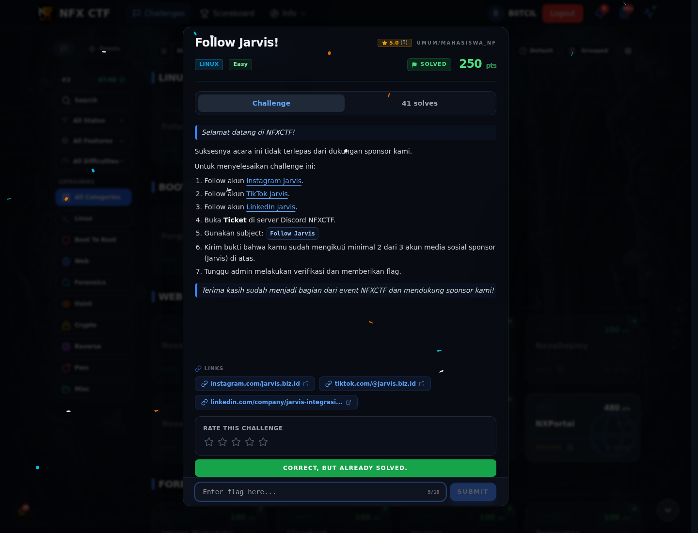

# Follow Jarvis! — Flag & Verifikasi

[← Overview](83-follow-jarvis.md) · [Index](index.md)

> **Langkah 2/5 — Cara Mendapatkan Flag.** Cara Mendapatkan Flag
>
> **Titik penting:** NFX{Th4nk_Y0u_F0r_Supp0rt1ng_NFXCTF_x_Jarvis}
>
> **Berikutnya:** [Flag](83-follow-jarvis-03-flag.md)

> **Flag:** `NFX{Th4nk_Y0u_F0r_Supp0rt1ng_NFXCTF_x_Jarvis}`
> **Status:** `VERIFIED`

1. Follow Instagram/TikTok/LinkedIn Jarvis (minimal 2).
2. Buka ticket Discord dengan subject `Follow Jarvis`.
3. Kirim screenshot bukti; flag diberikan admin.

### Bukti submit di platform

*Submit flag di platform: `CORRECT, BUT ALREADY SOLVED.`*

> **Bukti submit:** screenshot form challenge di atas menampilkan `CORRECT, BUT ALREADY SOLVED.`
