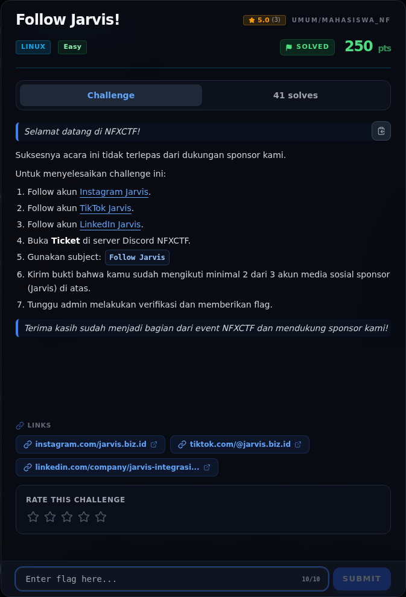
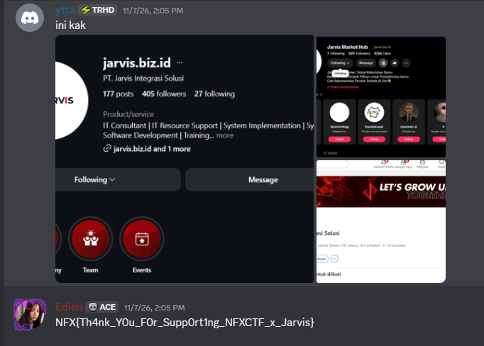

# Follow Jarvis!

Track Mahasiswa NF · LinuxEasy250 poinVERIFIED

| Field | Nilai |
|---|---|
| Event | `umum/mahasiswa_nf` |
| Kategori | `Linux` |
| Author | `—` |
| Difficulty | `Easy` |
| Poin | `250` |
| Flag | `NFX{Th4nk_Y0u_F0r_Supp0rt1ng_NFXCTF_x_Jarvis}` |
| Status | `VERIFIED` |
[← Kembali ke Index](index.md)

## TL;DR

- **Flag:** `NFX{Th4nk_Y0u_F0r_Supp0rt1ng_NFXCTF_x_Jarvis}`
- **Baca langkah lengkap:** [Cara Mendapatkan Flag](83-follow-jarvis-02-cara-mendapatkan-flag.md)

## Challenge Brief (platform)

*Challenge brief asli di platform NFX CTF 2026.*

## Alur & Titik Penting

| # | Langkah | Titik penting | Buka |
|---:|---|---|---|
| 1 | Recon | follow minimal dua akun Jarvis, lalu buka ticket Discord. | [Buka](83-follow-jarvis-01-recon.md) |
| 2 | Cara Mendapatkan Flag | NFX{Th4nk_Y0u_F0r_Supp0rt1ng_NFXCTF_x_Jarvis} | [Buka](83-follow-jarvis-02-cara-mendapatkan-flag.md) |
| 3 | Flag | NFX{Th4nk_Y0u_F0r_Supp0rt1ng_NFXCTF_x_Jarvis} | [Buka](83-follow-jarvis-03-flag.md) |
| 4 | Bukti / Evidence | arsip screenshot dan transkrip | [Buka](83-follow-jarvis-04-bukti-evidence.md) |
| 5 | Referensi | Ticket Discord, sponsor challenge. | [Buka](83-follow-jarvis-05-referensi.md) |

## Cerita singkat

Challenge sponsor. Kita follow minimal dua akun Jarvis, buka ticket Discord, kirim bukti, lalu admin memberi flag.

Pratinjau evidence. Buka halaman <a href="83-follow-jarvis-04-bukti-evidence.html">Evidence / Bukti</a> untuk semua screenshot dan transkrip.

## Navigasi Halaman

<a class="nx-page-card" href="83-follow-jarvis-01-recon.html"><b>Recon</b>Enumerasi target dan bukti awal</a>
<a class="nx-page-card" href="83-follow-jarvis-02-cara-mendapatkan-flag.html"><b>Cara Mendapatkan Flag</b>Flag dan verifikasi platform</a>
<a class="nx-page-card" href="83-follow-jarvis-03-flag.html"><b>Flag</b>Flag dan verifikasi platform</a>
<a class="nx-page-card" href="83-follow-jarvis-04-bukti-evidence.html"><b>Bukti / Evidence</b>Screenshot, transkrip, dan artefak</a>
<a class="nx-page-card" href="83-follow-jarvis-05-referensi.html"><b>Referensi</b>Sumber dan bacaan lanjutan</a>

