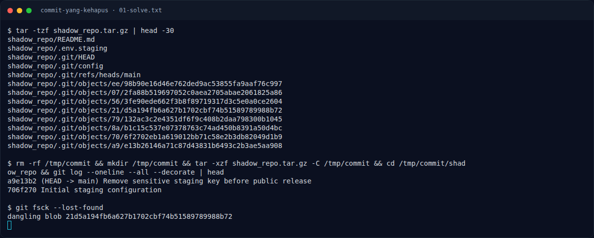

# Commit yang kehapus — Flag & Verifikasi

[← Overview](84-commit-yang-kehapus.md) · [Index](index.md)

> **Langkah 2/5 — Cara Mendapatkan Flag.** Cara Mendapatkan Flag
>
> **Titik penting:** NFXCTF{g1t_d4ngl1ng_bl0b_h4v0c_5c8a19d4}
>
> **Berikutnya:** [Flag](84-commit-yang-kehapus-03-flag.md)

> **Flag:** `NFXCTF{g1t_d4ngl1ng_bl0b_h4v0c_5c8a19d4}`
> **Status:** `VERIFIED`

1. Clone repo.
2. Jalankan `git fsck --lost-found` untuk mencari dangling blob.
3. Baca blob, susun key, dekripsi ciphertext.

### Terminal evidence (real)

*Terminal evidence (real).*

> **Bukti:** terminal evidence (real).
